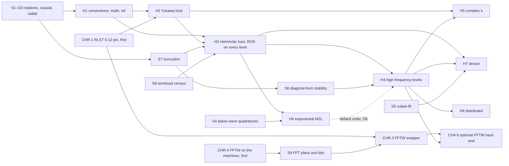

# Helmholtz-family FMM in 3D: design proposal

Draft 0.8, 2026-10-26. A proposal for review, not a plan: nothing here is signed off, and no
convention changes. It turns the design discussion of 2026-10-20 (the wideband literature,
the fit with this repository, the expected values of p, the practical record of the
Gumerov–Duraiswami scheme) into an architecture, a list of risks, a validation plan and a
phased plan with gates. Section 12 lists the decisions the proposal needs from the user.
Appendix A keeps the revision history; Appendix B describes the numerical check behind
Section 3.6 and contains the seed script for spike S6.

What draft 0.8 changes, after a review of draft 0.7 against RLST 0.12 (released 2026-10-26;
the FFTW rework shipped in 0.11.0 on 2026-10-25):

- **Phase HR's RLST part is done (Sections 6.7 and 10).** RLST 0.11.0 implements every task
  nd-fmm needed: CHR.1 is complete, D14 closed, R19 retired. What remains is nd-fmm's own
  adoption: the pin move (CHR.2), the wrapper (CHR.3) and the machines' FFTW (CHR.4).
- **CHR.2 rewritten and moved to the front.** RLST 0.12 removes `rlst::simd`, which
  green-kernels uses, so the `[patch]` for green-kernels stays on 0.10.2; octree's own pin
  moves with the workspace's; the lock-file condition becomes a `cargo tree -e normal` check.
  CHR.2 is the first implementation task, before CH2.0, so that D9's Laplace baseline is
  measured once. New risks R21 (the pin move) and R22 (system FFTW).
- **New early task CHR.4**: the FFTW builds of the machines of record (both precisions,
  version, SIMD) and RLST's own FFTW tests on them, before S9.
- **One FFTW back end (Section 6.7).** RLST has only `fftw_system`; nd-fmm's `fftw` feature
  forwards to it. D13 is withdrawn: RLST ≥ 0.11 has no `fftw_mkl`.
- **Interleaved scratch, not split plans, for the φ step (Sections 3.3 and 6.7).** RLST's
  measurements put split plans at 1.5–2.8× the interleaved time on a SIMD build of FFTW; the
  zero-padding scatter of the φ step writes interleaved scratch at no extra cost.
- **Rank invariance with FFTW (Sections 6.6 and 6.7, R15).** Its preconditions are stated
  (the same FFTW build, SIMD support and wisdom on every rank); plan fingerprints are
  compared across ranks at build, and nd-fmm uses no wisdom.
- **S9 on RLST 0.12 (CH0.9)**, outside the workspace, at the real batch of 2P − 1 rings and
  padded to 2P, on all three machines; Homebrew's FFTW on the M3 Max has no SIMD (D7).
- Smaller corrections are listed in Appendix A.

The review of draft 0.7 read the repositories only (RLST at `v0.12.0`, nd-fmm's `main`,
green-kernels' pinned rev) and compiled nothing. Every compilation and test it could not
run is scheduled in CHR.2, CHR.4, CH0.9 and CHR.3, the first two as the first
implementation tasks (Section 10).

> `docs/CONVENTIONS.md` takes precedence over this document. The Helmholtz quantities need
> a new CONVENTIONS section (proposed in Section 4 as §3.15); §3.1–§3.14 are not touched.

Recommendation in one paragraph: treat Yukawa, real-k Helmholtz and complex-k Helmholtz as
one kernel family, e^{ik|x−y|}/(4π|x−y|) with Im k ≥ 0, and build it as a separate
`HelmholtzOperator` behind the existing level-batched `FmmOperator` interface. Use the
skeleton of Gumerov and Duraiswami (2009): expansions in spherical Bessel and Hankel
functions times real **orthonormal** spherical harmonics on every level, and M2M and L2L by
rotation, coaxial translation and rotation back (RCR) on every level, real operators for
real k. On levels whose boxes span several wavelengths, the M2L converts each box once to
far-field signatures, translates diagonally and converts back, for the offset classes where
a rounding bound shows the diagonal form stable and faster; the nearest classes stay on
RCR. On the low-frequency levels the host tuner picks the M2L among Rotation, the
table-based strategies (small p only) and an exponential (plane-wave) M2L that generalises
Phase 6 T13. Yukawa runs on a real path with pruning of the coarse levels. Leaves stay a
fraction of a wavelength wide. Share the octree, `nd-fmm-plan`, the evaluator, the
distribution and the build and benchmark infrastructure; share the host drivers with Laplace
through monomorphised generics where the rule of Section 2 holds, first for Yukawa. Build
RCR on every level first, since it is correct at any kD; then the exponential M2L, which
carries most of the far-field work below kD ≈ 10³; then the high-frequency levels. FFTW
stays an optional back end that no phase depends on.

## 1. Purpose, scope and non-goals

### 1.1 The kernel family

All three cases are G_k(x, y) = e^{ik|x−y|}/(4π|x−y|) with Im k ≥ 0 and k ≠ 0 (k = 0 is
the Laplace FMM):

| Case | k | Kernel behaviour | Arithmetic |
| --- | --- | --- | --- |
| Modified Helmholtz (Yukawa) | k = iκ, κ > 0 | e^{−κr}/(4πr), decaying, no oscillation | real (real charges) |
| Helmholtz, real wavenumber | k > 0 | oscillatory, no decay | complex locals; real M2M and L2L |
| Helmholtz, complex wavenumber | Re k > 0, Im k > 0 | oscillatory and decaying | complex |

What decides the algorithm on a level l is not k but two dimensionless numbers, with a_l
the radius of the circumsphere of a box (a_l = (√3/2) w_l for box width w_l):

- **κ_r(l) = Re k · a_l**, the oscillation across a box. It sets p_l (Section 3.5) and,
  through the rounding bound of Section 3.6, which offset classes may use the diagonal form.
- **κ_i(l) = Im k · a_l**, the decay across a box. Where the decay over the shortest
  V-list distance makes the far field of a level negligible, that level is pruned
  (Section 5.5).

### 1.2 In scope

- Charges, potentials and gradients first, with **complex charges first-class** on every
  path (Section 3.3): a boundary-element iterate is complex for real and complex k alike.
  Dipoles (for Burton–Miller and double-layer operators) through the source-type interface
  of C6.4 once it exists for Laplace.
- Several charge vectors (CONVENTIONS §3.13, C6.3).
- f64 first; f32 only where Section 6.5 and spike S6 show it holds.
- The host path, then the device path, then the distributed path, in that order
  (Section 10), as for Laplace.

### 1.3 Non-goals

- Directional methods (Engquist–Ying, Messner–Schanz–Darve, Börm–Melenk), DMK and
  kernel-independent schemes. These were considered and excluded in the discussion;
  Section 11 records why.
- Maxwell, layered media, periodic boundary conditions.
- Any change to a Laplace kernel, table, layout or default. The one additive change that
  Section 3.7 may need, a maximum leaf width in `nd-octree` that defaults to none, leaves
  Laplace's trees as they are.
- High-frequency levels in f32, unless spike S6 shows offset classes stable in f32. Since
  Metal and WGSL have no f64 (constraint 8), this means no high-frequency Helmholtz on
  Metal: the M3 Max runs the Helmholtz host path and low-frequency device configurations
  only (decision D3).
- A dependency on FFTW in any default build, or on the critical path of any phase.

### 1.4 Guiding principle

Performance wins over a unified code base. That does not exclude shared generic code:
Rust monomorphises generics, so a generic parameter costs nothing at run time by itself, and
`LaplaceOperator` already dispatches its strategy at run time, per translation (the
`Families` enum inside `Tables`, matched in `m2l_at`) and per level call (the optional
plane-wave kernels), at measured cost. What can cost performance is how shared
code is written: strides that become runtime values in inner loops, kernel arithmetic that
no longer inlines into a `#[target_feature]` function, a changed order of operations, or
dispatch per coefficient or per sample. So code is shared when it passes the rule of
Section 2 (constraint 1), checked by measurement, and Helmholtz gets its own code where it
does not.

## 2. Constraints from the existing code

These follow from `docs/design/laplace-fmm-plan.md`, CONVENTIONS and `CLAUDE.md`, and the
proposal keeps every one of them.

1. **Laplace protected by a measurable rule.** Code shared with Laplace, including Laplace
   code made generic for Helmholtz, is allowed when all four conditions hold:
   1. **No new runtime dispatch below the level call.** Kernel choices are type parameters,
      associated constants or const generics, resolved at compile time; strides and plane
      counts in inner loops stay compile-time constants for Laplace.
   2. **Laplace's layouts and table formats unchanged**: CONVENTIONS §3.6, §3.7 and
      §3.12–§3.14 and the on-disk table cache.
   3. **Laplace's outputs bit for bit unchanged**, checked by the existing fixtures and the
      bit-identity tests across threads, overlap and ranks.
   4. **Laplace's benchmarks within noise** on the machines of record (the M3 Max, locust and
      Kathleen): the Phase 3S throughput gate of C3S.4 (at least 90 % of the spike), the
      device gates, and the cost constants of the tuner and of node-m2l.md. "Within noise"
      is defined by repeating the baseline on each machine (decision D9).

   The pull request that introduces shared code shows all four. If one fails, the Helmholtz
   side gets its own copy instead, and the Laplace code is left as it was.
2. **Determinism and rank invariance.** The output on P ranks is bit for bit the one-rank
   output over the union of the points, at every thread count and overlap setting, as for
   Laplace (laplace-fmm-plan §5.4).
3. **The level-batched interface.** Helmholtz implements
   `nd_fmm_plan::operator::FmmOperator`. `Value` stays a real scalar; complex quantities
   are stored as real planes. `multipole_size(level)` and `local_size(level)` already may
   vary by level, which a level-dependent p_l needs, and may differ from each other, which
   real multipoles with complex locals need (Section 3.3).
4. **No complex type on the device** (laplace-fmm-plan §6.3). Every device kernel works on
   real scalars.
5. **Tables in f64 on the host**, rounded when stored (§6.2), in the versioned cache of
   `nd-fmm-tables`.
6. **Every fast path is tested against a slower trusted path**: direct sums, addition
   theorems, reference operators in `nd-fmm-ref`.
7. **Table memory is a node budget** ([node-m2l.md](node-m2l.md)): the strategy rule sees
   the tables of a rank and of all the ranks of a node. With level-dependent tables and
   signature scratch this budget becomes the binding constraint (Section 7).
8. **Precision is a capability** (§6.2): no f64 on Metal or WGSL; f64 on CUDA and the CPU
   runtime.
9. **Decisions from data-independent inputs.** Every per-level and per-class decision (p_l,
   the regime, the M2L of an offset class, pruning, the FFT grid) is a function of k, the
   global tree geometry, the tolerance and the calibration tables only, never of the charges
   or of a rank's share of the boxes. Every rank then makes the same decisions, and
   constraint 2 can hold.

## 3. Mathematical framework

### 3.1 Expansions

With real orthonormal spherical harmonics Y_n^m (m = −n..n), spherical Bessel functions
j_n and spherical Hankel functions of the first kind h_n = h_n^{(1)}:

```math
\frac{e^{ik|\mathbf{x}-\mathbf{y}|}}{4\pi|\mathbf{x}-\mathbf{y}|}
= ik \sum_{n=0}^{\infty} j_n(k r_<)\, h_n(k r_>) \sum_{m=-n}^{n} Y_n^m(\hat{\mathbf{y}})\, Y_n^m(\hat{\mathbf{x}})
```

for |y| = r_< < r_> = |x| about a common centre. A multipole expansion of box b is
Σ M_nm h_n(kρ) Y_n^m(ρ̂) about its centre, a local expansion Σ L_nm j_n(kρ) Y_n^m(ρ̂).
The factors ik and 1/(4π) are applied once (Section 4, item 1), so no coefficient below
carries them.

**Which quantities are real.** For real k, j_n is real and h_n is not:

- P2M (j_n) and L2P (j_n) are real operators; P2L and M2P (h_n) are complex.
- The coaxial (R|R) coefficients re-expand j_n(k|r − t|) Y_n^m(r − t) about the origin. For
  real k this is a real function, expanded in the real basis j_{n′}(kr) Y_{n′}^{m′}(r̂), so
  the coefficients are real. For |r| > |t|, (S|S) = (R|R) (Gumerov and Duraiswami 2003). So
  M2M and L2L are real operators for real k, as the rotations are (Section 3.2). Only the
  (S|R) coefficients of the M2L, which carry h_l(kt), are complex.
- With real charges and real k the multipoles therefore stay real through the whole upward
  pass; the locals are complex. With complex charges, M2M and L2L act on the two planes of
  an expansion as a real operator on two columns.
- For complex k every operator is complex.

For Yukawa, k = iκ: j_n(iz) and h_n(iz) are i^n and i^{−n} times real multiples of the
modified spherical Bessel functions i_n(z) and k_n(z), so in the product of the series the
powers of i cancel per degree. Absorbing them into the scaling makes every coefficient and
every table real. The constants are part of §3.15 (Section 4).

### 3.2 Why an orthonormal basis, not the Laplace basis

The Laplace basis of CONVENTIONS §3.3 is Racah-normalised: Rₙᵐ = rⁿ Pₙᵐ e^{imφ}/(n + m)!
and Iₙᵐ = (n − m)! Pₙᵐ e^{imφ}/r^{n+1}. Against orthonormal harmonics, its scale factors
within one degree span √((n!)²/(2n)!) ≈ 2^{−n}, so the entries of a rotation block in the
Racah basis span (2n)!/(n!)² ≈ 4ⁿ: about 10⁵⁹ at n = 100, 10¹⁷⁹ at n = 300 and beyond the
f64 range near n ≈ 515. Its regular harmonics of order m = n at unit scaled radius fall
like 1/(2ⁿ n!), below 10^{−307} near n = 150. The high-frequency levels need degrees of 100
to 700 (Section 3.5). An orthonormal basis keeps every coefficient and every rotation block
of order one: N Dⁿ N⁻¹ is orthogonal (CONVENTIONS §3.8).

What carries over: at low degree the orthonormal blocks are the existing blocks conjugated
by N, so `nd_fmm_math::rotation::blocks` serves as the reference and as the generator up
to the degree where the conjugation stays accurate (spike S1, Section 10). Above it, the
blocks come from a recursion that is stable at large degree (Section 8, R1).

### 3.3 Storage

- **Complex expansions**: the locals whenever Re k ≠ 0, the multipoles for complex k, and
  every expansion of complex charges. Two real planes per box, real part then imaginary
  part, each in the index layout idx(n, m) = n² + n + m of CONVENTIONS §3.6, so
  2(p_l + 1)² reals per charge vector. Split planes, not interleaved pairs: a real operator
  (a rotation block, and for real k the M2M and L2L coaxial steps) then acts on both planes
  as two columns of one product, and the device GEMM sees real matrices (Section 6.5).
- **Real expansions**: Yukawa with real charges, multipoles and locals; real k with real
  charges, multipoles only. (p_l + 1)² reals. For real k with real charges,
  `multipole_size` is (p_l + 1)² m and `local_size` is 2(p_l + 1)² m.
- **Complex charges.** One complex charge vector arrives as two real input planes
  (q_r, q_i) and forms **one** complex expansion at P2M, never two, so it costs the storage
  of one complex expansion. Outputs are split planes as well: two reals of potential and six
  of gradient per target and vector. On the Yukawa path a complex charge vector is two real
  vectors, which is the same storage. The layouts are §3.15 item 9 (Section 4).
- **Several charge vectors**: as §3.13, m expansions one after the other.
- **Signatures**, on levels that use the diagonal form: complex samples on a (θ, φ) grid
  (Section 5.4), scratch of one level call, each box in its own aligned buffer
  (Section 6.7). On the host they are interleaved complex values whatever the φ back end,
  the storage FFTW's SIMD codelets need (Section 6.7); expansions stay in split planes, and
  the scatter and gather of the φ step convert between the two. The device keeps split
  planes (Section 6.5). At about 7.8 times the coefficients of a box they are the largest transient
  allocation (Section 7); the level call keeps the source signatures and processes the
  target accumulators in chunks under the node budget (Section 5.4).

### 3.4 Scaling

Each level uses a scale s_l and scaled radial functions so that the scaled coefficients and
the radial functions stay of moderate size at every degree used on that level. The model
is FMM3D's: s_l = min(|k| r_l, 1) with r_l the half-width, multipoles divided and locals
multiplied by s_lⁿ (or the reverse, with the radial functions scaled to match). At low
frequency the scaled j_n still carry 1/(2n + 1)!!, about 10^{−101} at n = 60: harmless in
f64, not in f32.

For Yukawa above κ r_l ≈ 1 the power scaling does not control i_n and k_n, which grow and
decay like e^{±κρ}. There the radial functions are stored with the exponential factor
removed (e^{−κρ} i_n and e^{κρ} k_n, as in FMM-Yukawa) and the factor is carried by the
translation coefficients. The exact definitions, and whether the double factorials are
absorbed into the basis, are decided by spike S3 and fixed in §3.15.

Test consequence: as k → 0 on a fixed tree, the scaled Helmholtz coefficients converge to
the scaled Laplace coefficients of §3.7 under a fixed diagonal map (the orthonormal–Racah
factors and the double factorials). The limit is asymptotic, not exact: the real parts
converge with corrections of order (k a)², and the imaginary part of the degree-0 term is
of order k a (it comes from j_0 in h_0 = j_0 + i y_0; for degree n it is of order
(k a)^{2n+1}). With tolerances that scale accordingly it is a cheap oracle for every
operator at low frequency (Section 9).

### 3.5 Truncation

On the high-frequency levels p is set by the box size in wavelengths, not by the accuracy:
an expansion about a box centre has to resolve the field's angular variation over the
circumsphere, and j_n(kρ) is negligible only once n exceeds kρ plus a transition zone of
width about (kρ)^{1/3}. Gumerov and Duraiswami (2009, eq. 18) choose, with δ = 2:

```math
p_{hi} = ka + \left(\tfrac{3}{2}\ln\tfrac{1}{\varepsilon}\right)^{2/3} (ka)^{1/3}, \qquad
p_{lo} = 1 - \frac{\ln\!\left(\varepsilon\,(1-\delta^{-1})^{3/2}\right)}{\ln\delta}, \qquad
P = \left(p_{lo}^4 + p_{hi}^4\right)^{1/4}
```

where P is a truncation number (degrees 0..P − 1); the degree in this repository's
convention is p = ⌈P⌉ − 1. Their bound is conservative (a prescribed 10⁻⁴ gave about 10⁻⁶
in their runs), and its floor p_lo is far above what this library's Phase 3 calibration
needs for Laplace (degree 12 for 10⁻⁶ in φ).

So p_l is calibrated empirically, as in C3.4, as a function of (k a_l, ε) and the operator,
not per kD band: levels at kD and at 2kD then share one calibration. Spike S7 produces the
first tables under realistic geometry; CH2.3, CH3.3 and CH4.3 confirm them in the full FMM.
Calibration matters twice: it lowers the cost of the low-frequency levels, and on
high-frequency levels a smaller P shortens the transfer functions and widens the range in
which the diagonal form is stable (Section 3.6).

Example, kD = 500 (D the side of the root cube, about 80 wavelengths), ε = 10⁻⁶, by the
formula above (before calibration):

| Level | Box width | k a_l | p_l | coefficients (complex) |
| --- | --- | --- | --- | --- |
| 2 | 19.9 λ | 108 | 144 | 21,025 |
| 3 | 9.9 λ | 54 | 82 | 6,889 |
| 4 | 5.0 λ | 27 | 50 | 2,601 |
| 5 | 2.5 λ | 13.5 | 33 | 1,156 |
| 6 | 1.2 λ | 6.8 | 25 | 676 |
| 7 | 0.6 λ | 3.4 | 23 | 576 |
| 8 | 0.3 λ | 1.7 | 22 | 529 (formula floor) |

Top level (level 2) against kD, at ε = 10⁻⁴ / 10⁻⁶ / 10⁻⁸:

| kD | D in λ | p_2 |
| --- | --- | --- |
| 50 | 8 | 24 / 30 / 35 |
| 100 | 16 | 37 / 43 / 48 |
| 200 | 32 | 63 / 69 / 75 |
| 500 | 80 | 135 / 144 / 151 |
| 1000 | 159 | 251 / 261 / 271 |
| 3000 | 477 | 699 / 714 / 728 |

Doubling kD moves the whole table up one level.

### 3.6 The diagonal form, its rounding, and the regimes

**What limits the diagonal form.** The high-frequency M2L of Section 5.4 multiplies a box's
signature (bandwidth P − 1) by the transfer function of its offset t,

```math
T(\hat{\mathbf{s}}) = \sum_{l=0}^{2P-2} (2l+1)\, i^l\, h_l(k|\mathbf{t}|)\, P_l(\hat{\mathbf{s}}\cdot\hat{\mathbf{t}}),
```

and projects the product back onto degrees below P with a quadrature that is exact for it.
In exact arithmetic this reproduces the truncated M2L that RCR applies, since the (S|R)
coefficients of degrees n, n′ < P involve h_l only for l ≤ n + n′ ≤ 2P − 2. The diagonal
form therefore adds no truncation error of its own. What limits it is rounding. h_l(x)
grows exponentially once l passes x, and here l reaches 2P − 2 ≈ 2ka +
2(3/2 ln 1/ε)^{2/3}(ka)^{1/3}, while x = k|t| is only 2.31 ka for the nearest offsets
(|t| = 2w, a = (√3/2) w). T then takes values up to about max_l (2l + 1)|h_l(k|t|)|, and
their rounding, of relative size u, lands in the projected result.

At kD = 500 and ε = 10⁻⁶ (the formula P of Section 3.5) the largest term at the nearest
offset is about 4·10⁶ on level 2, 3·10⁹ on level 3, 2·10¹² on level 4 and 10¹⁵ on level 5.
An axisymmetric f64 test of the scheme as specified (Appendix B) gives relative errors of
1·10⁻⁷, 8·10⁻⁵, 1.5·10⁻² and about 10 at |t| = 2w on levels 2 to 5, and below 10⁻⁸ on the
same levels at |t| = 3w.

**The bound.** Those runs follow, within about 3×, the estimate

```math
E(l, c) = C_T \cdot k|\mathbf{t}_c| \cdot u \cdot \max_{j \le 2P_l - 2} (2j+1)\,|h_j(k|\mathbf{t}_c|)|
```

for an offset class c at distance |t_c| on level l, with C_T ≈ 2 and u the unit roundoff
(1.1·10⁻¹⁶ in f64, 6.0·10⁻⁸ in f32). With the formula P of Section 3.5:

| ε | level switch of draft 0.6 (P − p_hi ≤ 2) | E there, nearest class | nearest class has E ≤ ε from |
| --- | --- | --- | --- |
| 10⁻⁴ | 1.4 λ boxes | ≈ 3·10⁻⁴ | 1.8 λ |
| 10⁻⁶ | 2.4 λ | O(1) | 17 λ |
| 10⁻⁸ | 3.5 λ | ≈ 10⁵ | 42 λ |

At 10⁻⁴, where Gumerov and Duraiswami worked, their switch and the bound roughly agree. At
tighter tolerances a switch per level would use the diagonal form where it is unstable.
Calibrated P helps: if the 10⁻⁴ formula reaches 10⁻⁶, as in their runs, the nearest class is
stable from about 3.7 λ at 10⁻⁶; the 10⁻⁶ formula used for 10⁻⁸ still needs about 26 λ.

These numbers come from a one-dimensional model of the proposal's reading of the paper (a
the circumsphere radius, bandwidth 2P − 2, one-box separation). If their code differs in
one of these, Sections 3.5 and 5.4 change instead. Spike S6 settles which, in full 3D, with
realistic point placements and calibrated P.

**The rule.** The M2L is chosen per offset class on a level, not per level:

- class c on level l uses the diagonal form if E(l, c) ≤ θ ε and the diagonal form is
  faster than RCR for that class on that level (CH4.3). θ ≤ 1 is a margin and C_T a
  constant, both set by S6; the numbers in this section use θ = 1 and C_T = 2.
- every other class uses RCR, which is correct on every level;
- a level converts to signatures only if some class passes and the level is faster that way,
  conversions included, with its signature scratch within the node budget (Section 7);
  otherwise the whole level runs RCR or a low-frequency strategy.

The bound costs a few hundred Hankel evaluations per (level, class) at build time and
depends only on k, w_l, P_l and the class (constraint 9). The classes that fail are the
nearest ones, so the hybrid keeps most of the diagonal gain. At kD = 500 and 10⁻⁶:

| Level | Box | k a_l | p_l | classes on RCR (\|t\|²/w²) | V pairs on RCR, full cube / sphere surface (W1) |
| --- | --- | --- | --- | --- | --- |
| 2 | 19.9 λ | 108 | 144 | none | 0 / 0 |
| 3 | 9.9 λ | 54 | 82 | 4 | 3 % / 6 % |
| 4 | 5.0 λ | 27 | 50 | 4, 5 | 16 % / 23 % |
| 5 | 2.5 λ | 13.5 | 33 | 4, 5, 6 | 29 % / 37 % |

At 10⁻⁸ level 2 already puts class 4 on RCR, level 3 classes 4 and 5, level 4 classes 4 to
6, and level 5 eight classes, two thirds of the pairs of an interior box. For W1 at
kD = 500 the hybrid takes the M2L work of levels 2–5 from 28 to 38 billion complex multiply-adds, against 62
with RCR on those levels; the low-frequency levels 6 and 7 take 126 billion with Rotation
(Section 7).

**f32.** u is 5·10⁸ times larger, so E ≤ 10⁻³ needs max_j (2j + 1)|h_j| below roughly
10² to 10³ (depending on k|t|) at the nearest classes: in f32 the diagonal form is confined to classes far from the
transition, if any. S6 measures it; until then no high-frequency level runs in f32 (D3).

**Complex k.** For Im k > 0 the plane waves and the transfer function grow with Im k times
the box size (Section 5.6); S6 runs the bound and the test over (Re k, Im k) as well.

**Regimes.** Per level the classifier assigns one regime from (κ_r(l), κ_i(l)), the
tolerance and the calibration:

| Regime | Condition | M2L |
| --- | --- | --- |
| **D**, decaying | the pruning test of Section 5.5 | none (V, W and X lists dropped) |
| **L**, low frequency | no class passes the rule above, or signatures do not pay on the level | Rotation, Dense, Classes, Batched (small p) or exponential |
| **H**, high frequency | some class passes and signatures pay on the level | diagonal for the passing classes, RCR for the rest |

M2M, L2L and the leaf operators do not depend on the regime. Even the low-frequency levels
reach p of 20 to 60 near the regime boundary, beyond the p ≤ 20 to which the Laplace M2L
is tested (CONVENTIONS §3.9).

### 3.7 Leaves and tree depth

The leaf operators, the phase range of P2P and the cost model assume leaves a fraction of a
wavelength wide. A tree refined only by points per leaf does not guarantee that: 10⁶
uniform points at kD = 500 give about 16,000 leaves of about 2.5 λ, with P2P across several
wavelengths and P2M and L2P at p ≈ 33.

The builder therefore refines every box that contains points and is wider than c_leaf λ, in
addition to the points-per-leaf rule, with c_leaf from spike S8 (initially between 0.5 and
1, decision D11). Consequences:

- every leaf is on a low-frequency level, and so are the W- and X-list operators: M2P reads
  boxes smaller than its target leaf, and P2L writes boxes smaller than its source leaf. The
  high-frequency levels carry only M2M, L2L and V lists;
- every P2P pair lies within about 2√3 c_leaf λ, so the phase k r stays below about
  22 c_leaf radians (Section 5.7);
- under-resolved inputs get more, sparser leaves instead of high-frequency ones; S8 measures
  the cost on the reference workloads (Section 9.1).

If `nd-octree` already takes a maximum depth or width, the builder passes it. Otherwise a
maximum leaf width is added to `nd-octree` as an optional parameter that defaults to none,
so that Laplace's trees and outputs are unchanged (constraint 1, checked in CH3.0). For
Yukawa there is no wavelength and the rule does not apply.

## 4. Proposed CONVENTIONS additions (§3.15, for separate review)

The Helmholtz quantities get one new section, CONVENTIONS §3.15, and a bump of
`CONVENTION_VERSION`. It would fix, at least:

1. **Kernel and factors.** G_k as in Section 1.1, the branch Im k ≥ 0, Hankel functions of
   the first kind (outgoing for the time factor e^{−iωt}), and where 1/(4π) and the factor
   ik of Section 3.1 are applied (by analogy with §3.1: once, by `nd-fmm-exec`).
2. **Angular basis.** Real orthonormal spherical harmonics: their definition from the
   associated Legendre functions of §3.3, the phase (with or without Condon–Shortley), the
   order of the cos and sin parts in the slots ±m, and the evaluation by recursion without
   trigonometric calls (§3.2).
3. **Radial functions and scaling.** j_n, h_n, and for Yukawa i_n, k_n with their
   normalisation; the scale s_l; the exponential scaling for Yukawa above κ r ≈ 1 if S3
   adopts it; the scaled coefficients of P2M, P2L, M2P, L2P; the powers of i absorbed for
   Yukawa (Section 3.1).
4. **Storage.** Split real and imaginary planes in the layout of §3.6 (Section 3.3); the
   real layouts and when they apply (Yukawa with real charges; real-k multipoles with real
   charges); one complex expansion per complex charge vector; several charge vectors as
   §3.13.
5. **Rotations.** Orthogonal blocks in the orthonormal basis, their relation to the blocks
   of §3.8 (conjugation by N), the z-y-z factorisation used by the tables, and the relation
   between the blocks of β and π − β used by M2M (S1).
6. **Coaxial translations.** The (S|R), (S|S) and (R|R) coaxial coefficients per order |m|
   with rectangular truncation p_l → p_{l±1}, and their recursions. (S|S) = (R|R), real
   for real k and for Yukawa; (S|R) complex for real and complex k; the index symmetry
   that halves the tables, as confirmed by S2.
7. **Signatures.** The (θ, φ) grid of a high-frequency level (Gauss–Legendre in cos θ,
   uniform in φ with the count padded to a multiple of 4 for the reflection classes of
   Section 5.4), their storage (interleaved complex on the host, split planes on the
   device), the index permutations of the 34 classes on that grid, the transforms
   S → F and F → R, the diagonal translation function and its bandwidth 2P − 2.
8. **Precision and range.** The degrees and arguments at which each family is tested, in
   the spirit of §3.9.
9. **Inputs and outputs.** k as (Re k, Im k) in f64; charges as split planes per vector,
   with a flag for real charges; potentials and gradients as split planes, and the order of
   the gradient components; the multipole and local sizes of each path (Section 3.3).

## 5. Operators

### 5.1 Leaf operators (P2M, L2P, P2L, M2P)

Per particle: the real orthonormal harmonics by recursion, and the radial functions by
recursion in the stable direction (j_n downward, Miller's method; h_n upward), for real and
complex arguments. As for Laplace, one thread per particle or per target, and the points
in leaf-scaled coordinates (CONVENTIONS §3.13), so the radial argument is (k r_leaf) times
a scaled distance of order one. Section 3.7 keeps every leaf, and with it every M2P and P2L,
on a low-frequency level: P2M and L2P arguments stay below k a_leaf ≤ 5.4 c_leaf, and the
M2P and P2L arguments below k times a few leaf widths.

### 5.2 M2M and L2L: rotation, coaxial translation, rotation back

On every level, as in Gumerov–Duraiswami. A translation from level l to l ± 1 rotates the
p_l coefficients so that the shift lies on +z, applies the coaxial (S|S) or (R|R)
translation, rectangular from p_l to p_{l±1} (which needs no separate interpolation or
filtering), and rotates back.

- **Rotations** are real and orthogonal (Section 3.2), applied to both planes of a complex
  expansion as two columns. The eight child shifts share the polar angles β and π − β,
  whose blocks are related by a signed permutation, and orthogonality gives the back
  rotation as the transpose, so a level needs one block set of
  B = (p + 1)(2p + 1)(2p + 3)/3 reals (`nd_fmm_tables::rotation` stores 2 B per polar
  angle): 31 MiB in f64 at p = 144, 183 MiB at p = 261. Above a degree measured in S1 the
  blocks are generated per level call from the recursion of Section 8 (R1) instead of
  stored.
- **Coaxial coefficients** depend on k times the shift and on |m|. (S|S) = (R|R) are real
  for real k and for Yukawa, complex for complex k (Section 3.1); tabulated per level,
  O(p³) reals per table. For real k the coaxial step of M2M and L2L is a real operator on
  both planes, like the rotations.
- Cost O(p³) per translation; at the top levels this is the term that makes the method
  formally O(p³) (Gumerov–Duraiswami 2009, §IV.B.1), acceptable up to kD of the order
  of 10³ (Section 7).

### 5.3 M2L on low-frequency levels

Strategies behind a `HelmholtzM2l` choice per level, resolved by a tuner as `M2lStrategy`
is for Laplace:

- **Rotation** (default, exact up to truncation): RCR with the M2L family's 47 polar
  angles and 32 azimuths (as `nd_fmm_tables::rotation`) and the complex coaxial (S|R)
  coefficients per level and distance (15 distances). O(p³) per V pair. It is correct on
  every level, so it also serves the offset classes of high-frequency levels that fail the
  rule of Section 3.6.
- **Dense**: one (p + 1)² × (p + 1)² table per (level, offset), complex for Re k ≠ 0 and
  real for Yukawa. It is only viable at small p: at p = 20 the 316 offsets take about 1 GB
  per level in complex f64, and every low-frequency level has its own tables.
- **Classes**: Dense over the 16 symmetry classes of CONVENTIONS §3.12, which cut the
  tables about 20-fold. On real orthonormal coefficients the cube-group elements that fix
  the z-axis (the reflections and the rotations by multiples of 90° about z) act by signed
  permutations; the elements that move the z-axis act by dense per-degree rotation blocks,
  O(p³) per application. Laplace's Classes already pays the latter; at the Helmholtz p of
  20 to 60 its cost is measured (CH3.2), not assumed.
- **Batched**: Laplace's Batched strategy carried over on the shared drivers, with
  per-level tables; like Dense, it never resolves where its tables exceed the node budget.
- **Exponential (plane-wave) M2L**, opt-in at first: the Helmholtz generalisation of
  CONVENTIONS §3.14 (Greengard, Huang, Rokhlin and Wandzura 1998; Cheng et al. 2006): the
  same six directions, rotations and merge and shift, with quadratures in which the
  integral splits into a propagating and an evanescent part. Three reasons to expect it to
  matter. Phase 6 T10 measured the Laplace plane-wave M2L at 2.2–9.8× the faster of Batched
  and Rotation at f64 p ≥ 8 on the M3 Max and locust, and 3.6–12.5× at p ≥ 12 on Kathleen
  (docs/phase6/README.md, decision 6). The Helmholtz low-frequency levels run at p of 20 to
  60, where an O(p²) per-pair M2L gains most. And the low-frequency levels carry most of the
  far-field work below kD ≈ 10³ (Section 7), which is why H6 comes before H4 by default.
  FMM3D uses this M2L for Helmholtz up to boxes of 32 wavelengths. The cost of entry: the
  quadratures depend on k w_l, so a level needs its own quadrature (generated or tabulated;
  spike S4), unlike the single Laplace table of §3.14. Gumerov and Duraiswami found RCR
  about as efficient as exponential forms at moderate p in their 2009 code; the
  repository's own Laplace measurement points the other way, so the decision is a
  measurement (CH6.2).

### 5.4 M2L on high-frequency levels: signatures

Gumerov–Duraiswami 2009, §IV.B.5, restricted to the offset classes that pass the rule of
Section 3.6:

1. **S → F once per box**, for every box that is the source of at least one diagonal pair.
   The spherical transform of the box's multipole to Nₗ = (2P − 1)(4P − 3) signature
   samples (Gauss–Legendre in cos θ times uniform in φ; P = p_l + 1): for each order m, a
   Legendre matrix in θ applied to all boxes of the level, then a discrete Fourier
   transform in φ along every θ ring of every box. The Legendre step is a product over all
   boxes of a level, the shape the level-batched interface and the device GEMM handle well;
   the parity of the Gauss–Legendre nodes halves it, and real multipoles halve it again.
   The φ step is the transform written as a product by default and a per-box FFT where a
   back end is available (Section 6.7).
2. **Diagonal translation** for the pairs whose offset class passes. For each target and
   each such offset, a pointwise complex multiply-add of the source's samples with the
   transfer function of (level, offset), accumulated in signature form. O(p²) per pair;
   bandwidth-bound.
3. **F → R once per box**, for every box that is the target of at least one diagonal pair,
   by the inverse transform. The RCR pairs of the same target are then added to its local
   in row order, after the F → R result, so the order of additions is fixed (constraint 2).

There is no interpolation or anterpolation between levels, because M2M and L2L stay in
spherical harmonics (Section 5.2). The transfer functions are the diagonal forms of the
translation operator, with bandwidth 2P − 2, computed in O(p³) per class at build time
(S6 checks whether interpolating T in ŝ · t̂ keeps the bound, which would make the build
O(p²) per class). Their memory is the dominant table cost (Section 7).

**Reflection classes.** The reflection symmetries of the grid reduce the 316 offsets per
level to 34 classes, as Cecka and Darve (2013) show for their uniform grid. On this grid the
reflection z → −z maps the Gauss–Legendre nodes to themselves, and x → −x, y → −y and x ↔ y
map the φ grid to itself when its count is a multiple of 4, so the count 4P − 3 is padded
(Section 6.7). A transfer function is stored once per class; an offset in the class reads
it through the index permutation of the symmetry that maps the offset to the class
representative. The permutation acts on T, which all pairs of that offset share, not on
the signatures; on the device the permuted T of one offset is materialised once per offset
group (Section 6.5). Classes that run RCR on a level store no transfer function.

**Scratch and chunking.** The source signatures of a level are formed once and kept for
the level call; the target accumulators are formed for a chunk of target boxes at a time,
sized from the node budget, and the chunks are walked in a fixed order, so the chunk size
does not change any bit. A rank also forms the signatures of the ghost sources it needs
(Section 6.6). Section 7 gives the sizes.

**Upgrade paths, only if needed.** If targets well beyond kD ≈ 10³ appear: Cecka and
Darve's Fourier-based representation on these levels, with diagonal M2M and L2L (phase
shifts and FFT resampling), which removes the O(p³) term of Section 5.2 and replaces the
representation of the high-frequency levels only. A two-box separation on the
high-frequency levels would stabilise the diagonal form much further down (at |t| = 3w the
test of Section 3.6 stays below 10⁻⁸ to level 5) but changes the U and V lists, so the plan;
it is not adopted (Section 11).

### 5.5 Yukawa

The Yukawa operator is the real case of the same code: real coefficients, real tables,
(p + 1)² reals per expansion, the Laplace-sized storage. Three properties are specific:

- **Pruning.** Level l is pruned when the largest kernel value its far-field lists can
  carry, relative to the kernel at a leaf width, is below θ_D ε:
  e^{−κ (w_l − w_leaf)} · w_leaf / w_l ≤ θ_D ε, with θ_D calibrated in CH2.3. The test is
  monotone in w_l, so pruning a level prunes every coarser one. On pruned levels the V, W
  and X lists are all dropped (empty M2L, M2P and P2L calls), the M2M and L2L calls above
  them are skipped, and the multipole and local buffers of those levels are zeroed, never
  read uninitialised. The test uses only κ, the widths and ε (constraint 9), so every rank
  prunes the same levels. For large κ the coarse levels disappear, and with them the
  replicated top's all-gather, the one term of the Phase 5S model that grows with P.
- **Real M2L**: every strategy of Section 5.3 applies in real arithmetic; the
  high-frequency regime does not occur.
- **Scaling** above κ r_l ≈ 1 as in Section 3.4.

Whether Yukawa is its own operator type or the wavenumber kind is a type parameter of one
operator is decision D4 (Section 6.3).

### 5.6 Complex wavenumber

The low-frequency operators carry over with complex arguments (the radial functions need
robust evaluation for complex k; spike S3). Decay helps both truncation and pruning; the
pruning test of Section 5.5 applies with Im k for κ. The high-frequency diagonal form needs
care: for Im k > 0 the plane waves and the transfer function grow with Im k times the box
size, so p_l, the grid and the bound of Section 3.6 need a damping-dependent rule; Grasso,
Chaillat, Bonnet and Semblat (2012) give one, tuned empirically for visco-elastodynamics,
and S6 measures it here. In practice strongly damped cases are pruned before they reach the
high-frequency levels; only weakly damped ones use them.

### 5.7 P2P

Potential and gradient of e^{ikr}/r: cos(kr)/r and sin(kr)/r (real k), e^{−κr}/r (Yukawa),
e^{−Im k r}(cos + i sin)(Re k r)/r (complex k); the gradient factor is (ik − 1/r). New
kernels in `nd-fmm-simd` for NEON and AVX2 + FMA (AVX-512 with C6.7), with vectorised
sincos and exp, under an accuracy contract like simd-p2p.md's, on a loop skeleton shared
with Laplace where constraint 1 of Section 2 holds (Section 6.2). The phase k r is formed
from k r_leaf (a per-tree constant formed in f64) times the leaf-scaled distance; with the
leaf rule of Section 3.7 it stays below about 22 c_leaf radians, and the accuracy contract
covers that range (for Yukawa, κ r up to the pruning cut). The cost per pair is several
times Laplace's; it is measured in CH2.4 and CH3.4, not assumed, with green-kernels'
Helmholtz and modified-Helmholtz kernels (on their own RLST 0.10.2, CHR.2) as an external
baseline after a convention check, as its Laplace kernel was in Phase 3S. The device kernels
are CH7.2.

## 6. Software architecture

### 6.1 Placement

Proposal A (recommended): Helmholtz modules inside the existing layer crates, next to the
Laplace modules, with drivers shared where Section 6.2 allows.

| Crate | New for Helmholtz | Shared with Laplace |
| --- | --- | --- |
| `nd-fmm-math` | orthonormal real harmonics; j_n, h_n, i_n, k_n for real and complex arguments, with the Yukawa scaling; orthogonal rotation blocks at any degree | `RealScalar`, the index layout, the low-degree rotation recursion (reference and generator) |
| `nd-fmm-ref` | direct-sum oracle for G_k; reference P2M … L2P; direct and RCR translations; the diagonal form in extended precision | test infrastructure |
| `nd-fmm-tables` | per-level coaxial, rotation, transfer-function (per class) and quadrature tables; per-level cache keys | the versioned cache, canonical frames, V-list and octant geometry |
| `nd-fmm-simd` | Helmholtz and Yukawa pair arithmetic (sincos, exp) | ISA dispatch, chunk layout, accuracy harness; the P2P loop skeleton (chunking, masking) generic over the pair kernel, if the C3S.4 gate holds |
| `nd-fmm-kernels` | device kernels for complex planes, the complex (S\|R) step, diagonal M2L, transforms, Helmholtz and Yukawa P2P, leaf operators with radial recursions; cubek-fft if S5 adopts it (a new dependency, D10) | GEMM kernels where the stacked form applies (Section 6.5) |
| `nd-fmm-exec` | `HelmholtzOperator<T, K>`, `HelmholtzM2l`, the classifier and the per-class rule, the builder with the leaf rule, the high-frequency levels; the host FFT back ends behind a trait of its own, FFTW only behind the optional `fftw` feature (Section 6.7) | `Fmm` plumbing, leaf-scaled loading, tuner and table-cache machinery, MPI and device hooks; from H2, the host drivers of Dense, Classes, Rotation and Batched, generic over the kernel, if the rule of Section 2 holds |
| `nd-octree` | only if missing: an optional maximum leaf width, defaulting to none (Section 3.7) | everything else |
| `nd-fmm-validate`, `nd-fmm-bench` | the reference workloads of Section 9.1 and their calibrations; a problem-file version with k and complex charges | harness, distributions, reporting, `--write-problem` and `--check-output` |
| `tools/fmm3d/`, `tools/fixtures/` (not crates) | `hfmm3d` in the driver; a fixture generator that runs it | T9's pinned build, driver, `run.sh` steps (`problems`, `sweep`, `match`, `time`, `crosscheck`) |
| `spikes/` (workspace members outside `default-members`, so never in CI, but in the root `Cargo.lock`; S9 outside the workspace, with a `[workspace]` table of its own, CH0.9) | S1–S9 | — |

Nothing in `nd-fmm-plan` changes. Proposal B (separate crates `fmm-helmholtz-*`) isolates
more but duplicates the build and test plumbing; decision D2.

### 6.2 Sharing code with Laplace

Rule of two: a shared skeleton is extracted from Laplace code only when its second user
is being built, and only if the pull request meets constraint 1 of Section 2. Before
that, nothing in Laplace is generalised in advance.

**Where sharing pays, and where it does not:**

| Part | Shared skeleton | Kernel-specific | Expected gain |
| --- | --- | --- | --- |
| Yukawa host M2L, M2M, L2L (Dense, Classes, Rotation, Batched) | the drivers: batch walking, gathers and scatters, threading, charge vectors, scratch | tables per (level, offset); coaxial coefficients; the cube-group coefficient transforms of Classes in the orthonormal basis; leaf radial functions | large: Yukawa is real with (p + 1)² storage, as Laplace |
| Helmholtz low-frequency levels | the same drivers, with complex expansions as two real columns per vector; for real k, M2M and L2L as real operators on those columns | the epilogue that combines the four real products of a complex M2L; complex (S\|R) coefficients | moderate |
| Helmholtz high-frequency levels | none (RCR classes reuse the low-frequency Rotation driver) | transforms, diagonal M2L, signature scratch, the per-class rule | none |
| P2P (`nd-fmm-simd`) | chunking, masking, ISA dispatch | the pair arithmetic | moderate |
| Leaf operators | per-particle loops, leaf-scaled frames | harmonics and radial recursions | small |
| Device | launch and buffer plumbing (already shared) | kernels; at most a comptime kernel parameter | small |

**The shape of the abstraction** (a sketch, not an API): the shared drivers take a kernel
type that supplies, at compile time, what differs.

```rust
/// What a translation kernel gives the shared host drivers (sketch).
pub(crate) trait TranslationKernel<T: SimdScalar> {
    /// Real columns per expansion and vector: 1 for Laplace and Yukawa, 2 for complex.
    const PLANES: usize;
    /// Whether M2M and L2L coefficients are real: Laplace, Yukawa and real k.
    const REAL_SHIFTS: bool;
    /// Degree on a level. Laplace returns the p its drivers receive today; where a
    /// Laplace inner loop is specialised on p at compile time, the kernel supplies it
    /// as a const generic instead (CH2.0 states which applies).
    fn degree(&self, level: usize) -> usize;
    /// The dense M2L table of an offset on a level; Laplace ignores `level`.
    fn m2l_dense(&self, level: usize, offset: usize) -> &[T];
    // octant tables, rotation and coaxial tables, leaf functions, the complex epilogue …
}
```

For Laplace the level argument is dead code after monomorphisation and `PLANES` is the
constant 1, so the generated loops are the ones the code has today; condition 4 of
constraint 1 checks that rather than assuming it. The complex case reuses the column
structure of several charge vectors (CONVENTIONS §3.13, C6.3): each vector's real and
imaginary planes are two columns. In Dense and Batched the products with [A_r; A_i] give
the four real products, which are accumulated over the offsets of a target and combined by
a kernel-specific epilogue once per target (Section 6.5). In Rotation the real blocks, and
for real k the real coaxial steps of M2M and L2L, act on both columns; only the (S|R) step
of the M2L is complex. The `#[target_feature]` functions of `nd-fmm-simd` keep the loop
skeleton inside them and take the pair arithmetic as `#[inline]` trait methods, so it
inlines into the feature context.

**Pitfalls the pull requests must show they avoid:** strides or plane counts that become
runtime values in inner loops; arithmetic that no longer inlines into a
`#[target_feature]` function; a changed order of operations or a new fusion of a multiply
and an add (which changes Laplace's bits); more CubeCL kernel variants than the autotune
cache and build times can carry.

**The real cost is re-verification, not run time.** Changing Laplace code means re-running
its gates on the M3 Max, locust and Kathleen, and re-measuring the tuner's cost constants and
the node budgets where timings move. CH2.0 carries that cost for the real drivers, CH3.5
for their extension to complex expansions.

**The order:**

1. **H2 (CH2.0):** make Laplace's real host drivers generic over the kernel and build Yukawa
   on them. If the pull request fails constraint 1, Yukawa gets copies and Laplace is left as
   it was.
2. **H3 (CH3.5):** if CH2.0 produced shared drivers, build the complex low-frequency
   operator on them by adding the two-plane case and the epilogue. That is again a change to
   Laplace code and meets constraint 1 again; if it fails, the complex operator gets its own
   drivers.
3. **Never** for the diagonal form of the high-frequency levels.

### 6.3 The operator

`HelmholtzOperator<T: RealScalar, K: Wavenumber>` implements `FmmOperator` with `Value = T`.
K is one of `Real`, `Complex` and `Imaginary` (Yukawa); the builder matches on k once and
constructs the monomorphised operator, so the kind is resolved above the level calls
(constraint 1, condition 1) and the real shifts of Section 3.1 are compile-time facts.

- `multipole_size(level)` = (p_l + 1)² m on the real paths with real charges (Yukawa; real
  k), else 2(p_l + 1)² m; `local_size(level)` = (p_l + 1)² m for Yukawa with real charges,
  else 2(p_l + 1)² m; m the number of charge vectors.
- Inputs and outputs in split planes as §3.15 item 9: charges (q_r, q_i) per vector, or q
  alone with the real-charge flag; potentials and gradients as split planes.
- It owns the per-level strategy, the per-(level, class) M2L choice of the high-frequency
  levels, the per-level tables (or references into a shared table object) and the scratch of
  the high-frequency levels (signatures of one level at a time).
- Level calls follow the batches of `nd-fmm-plan` exactly as `LaplaceOperator`'s do: M2L by
  target rows on the host, by offset groupings on the device, each target's contributions
  added in a fixed order (Section 5.4), so determinism and rank invariance follow as for
  Laplace.
- On a pruned level (Section 5.5) the M2L, M2P and P2L calls are empty, the M2M and L2L
  calls above it are skipped and its buffers are zeroed; the plan is unchanged.

The builder takes k, the tolerance and the domain, sets the leaf rule of Section 3.7,
resolves p_l, the regime, the per-class choice and the strategy per level, and builds or
loads the tables.

**Table cache.** Tables are cached per level, keyed by (path K, k w_l as the bits of its
real and imaginary parts, p_l, the per-class choices, the grid N_φ, precision, the
calibration-table version, the convention version). Since doubling kD moves every level
down by one, a frequency sweep in octaves reuses every level's tables except the new top
level's. The on-disk cache is bounded by a byte cap with least-recently-used eviction, set
in the builder, because a sweep would otherwise grow it by the tables of every frequency.
Their build cost is reported per frequency (Section 7).

Two `Fmm`s at two tolerances on one tree (an accurate one for the outer solve and a cheap
one inside a preconditioner, which Gumerov and Duraiswami found worth a 3× in time) should
share the plan and the points; the builder allows that.

### 6.4 Strategy selection

Per level, as Laplace's `Auto` on a node: the regime first (Section 3.6). On high-frequency
levels, per offset class, the diagonal form or RCR by the bound of Section 3.6 and by
measured time, and for the level as a whole signatures or not, by time and by the node
budget, in which the signature scratch counts like tables (Section 7). On low-frequency
levels, among Rotation, Dense, Classes, Batched and the exponential M2L, by the node budget
of node-m2l.md (bytes of a rank and of a node) and by measured cost constants. Dense never
resolves on a level whose tables exceed the budget. The exponential M2L is opt-in until
CH6.2 has measured it.

### 6.5 Device path

- **Split planes, real kernels.** A complex product Y = A X with A = A_r + iA_i is one real
  GEMM of the stacked table [A_r; A_i] with the columns [X_r, X_i], followed by an epilogue
  that forms Y_r = A_r X_r − A_i X_i and Y_i = A_i X_r + A_r X_i. That reuses the
  hand-written comptime-p GEMM without duplicating table storage; a dedicated complex
  kernel (3M, or fused complex FMAs) replaces it only if it measures faster.
- **Rotation and coaxial kernels.** Real orthogonal blocks on both planes; for real k and
  Yukawa the coaxial step of M2M and L2L is real as well. Only the (S|R) step of the M2L,
  and every step for complex k, is a small complex kernel per order.
- **Diagonal M2L** is an elementwise complex multiply-add per (target, offset) over the
  signature samples: a gather kernel, bandwidth-bound. The transfer function of an offset
  is the class's, read through the class permutation and materialised once per offset
  group.
- **Transforms** S ↔ F: per order m, a Legendre matrix times all boxes of the level (GEMM);
  in φ a batched FFT from cubek-fft if spike S5 adopts it, else a DFT written as a GEMM
  (Section 6.7). Device and host may use different φ grids (power of two against smooth
  sizes), so device and host agree on locals within error, not on signatures.
- **P2P.** Helmholtz and Yukawa pair kernels in real arithmetic (sincos and exp on split
  planes), under an accuracy contract like the host's, with the phase range of
  Section 3.7 (CH7.2).
- **Leaf operators.** P2M, L2P, M2P and P2L with the harmonic and radial recursions in real
  arithmetic, one thread per particle or target, as Laplace's (CH7.3).
- **Exponential M2L** on the device if D8 adopts it on the host (CH7.5).
- **Precision.** f64 on CUDA and the CPU runtime. f32 (Metal) only for low-frequency
  configurations whose p_l and arguments pass the f32 accuracy contract; no high-frequency
  level in f32 unless S6 finds classes stable in f32 (D3).

### 6.6 Distributed path

- Variable expansion sizes per level are already supported by the exchanges of
  `nd-fmm-plan`; the locally essential set and the owned top tree carry over.
- **The replicated top needs a byte cap, not a box cap.** Phase 5S replicates at most 4,096
  boxes. With Helmholtz the top levels are the large-p levels. At ε = 10⁻⁶ the complex f64
  multipoles of levels 2 to 4 take, on every rank:

  | Workload | kD = 200 | kD = 500 | kD = 1000 |
  | --- | --- | --- | --- |
  | full cube | 80 MiB | 237 MiB | 662 MiB |
  | W1 sphere surface (Section 9.1) | – | 93 MiB | 268 MiB |

  Real multipoles (real k with real charges) halve these. A node with R ranks holds R
  copies: with 40 ranks per node, the full-cube top at kD = 1000 is 26 GiB per node and
  W1's 10 GiB. The node budget of node-m2l.md therefore counts the replicated top with the
  tables, and above the cap the top boxes travel along the forwarding tree instead of being
  replicated (CH8.1).
- **Open:** on high-frequency levels, whether ranks exchange multipoles and convert to
  signatures locally (about 8× less traffic per box, with the conversion repeated on each
  reader) or exchange signatures. With the product transform, or with per-box FFT plans
  under the preconditions of Section 6.7 (one FFTW build and SIMD class on every rank, plan
  fingerprints compared at build), a signature recomputed on another rank is bit for bit
  the same, so both keep rank invariance. A question for CH8.1, not for the start.
- Rank invariance is required as for Laplace: every reduction in fixed order, and every
  decision data-independent (constraint 9).

### 6.7 Fourier transforms

**Where an FFT pays.** Only in the φ step of the conversions S → F and F → R on the
high-frequency levels (Section 5.4), and later in the Cecka–Darve upgrade. Laplace, the
low-frequency levels and the exponential M2L do not use one, and nothing in Laplace changes.

Per box, the Legendre step in θ costs about 2P³ complex multiply-adds whichever way φ is
done. The φ step maps 2P − 1 modes on each of the 2P − 1 rings to N_φ ≈ 4P samples: about
16P³ as a product, about 2P · (N_φ/2) log₂ N_φ as an FFT. An FFT therefore cuts a
conversion by 5–8×. The diagonal M2L is unchanged and grows with the grid, so the gain per
box is smaller. Cost per box of a high-frequency level (forward and inverse conversion and
a diagonal M2L with 189 sources), in millions of complex multiply-adds, an FFT butterfly
counted as one, before any measurement of efficiency:

| p | power-of-two padding | DFT as a product | power-of-two FFT (cubek-fft) | FFT on smooth sizes (FFTW) |
| --- | --- | --- | --- | --- |
| 33 | 1.88× | 3 | 4 | 2 |
| 50 | 1.25× | 9 | 6 | 5 |
| 82 | 1.54× | 31 | 19 | 13 |
| 144 | 1.77× | 141 | 71 | 46 |
| 261 | 1.95× | 749 | 286 | 185 |

(Padding relative to the multiple of 4 above 4P − 3.) One measured point, indicative
(RLST's design, Section 10.2): one forward φ transform of one box at p = 144, 289
transforms of length 588, took about 0.59 ms on one AVX2 core with Ubuntu's FFTW 3.3.10,
and 1.23 ms with FFTW built without SIMD. The effect on a whole run is bounded:
it lowers the cubic term in kD (Section 7), which is negligible below kD ≈ 200 and grows
from several hundred on, and only on levels and classes that use the diagonal form
(Section 3.6).

**Not on the critical path.** No phase depends on an FFT. The transform written as a
product is complete, the default, and the reference against which every other back end is
tested. Spike S5 (cubek-fft) is assessed against the product in f64 and against an
extended-precision DFT, not against FFTW. The RLST rework (Phase HR) is done, in RLST
0.11.0 (2026-10-25) and 0.12.0 (2026-10-26); only CH4.6, the optional FFTW back end, uses
it, through CHR.2 and CHR.3.

**Grid sizes.** N_φ ≥ 4P − 3 is a per-level choice, recorded in the table cache key: on
the host a multiple of 4 whose other prime factors are at most 7 (580 → 588, 1048 → 1080;
204 → 216 at p = 50), at most about 10 % above 4P − 3 from p ≈ 33 and 7 % from p ≈ 82; on
a device level that uses cubek-fft, a power of two (1.25–1.95×). The transform written as a
product works with either. The padding enters the memory of signatures and transfer
functions (Section 7).

**Plans per box.** A box's φ step is one plan of 2P − 1 rings of length N_φ (FFTW's
howmany = 2P − 1, or 2P with one zero ring if S9 finds an even batch faster), fixed per
level, made once for alignment class 0 and executed on the box's own aligned buffer by
whichever worker holds the box. FFTW, like any planner, may choose different codelets,
including SIMD across the batch dimension, for a different howmany, stride or alignment
(RLST's design, Section 3 item 7: for length 588, the plan for 288 transforms differs from
the plan for 289). A plan over all boxes of a level, or over chunks of varying size, would
therefore make a box's bits depend on how many boxes its rank owns and on how the batch is
split, which breaks constraint 2. One plan per (level, N_φ), executed box by box, avoids
that by construction.

With RLST 0.12 (`rlst::fftw`): a layout from `Layout::along_axis` over the box's
[N_φ, 2P − 1] buffer, a c2c plan from `Planner::<f64>::new()`, whose rigor is
`Rigor::Estimate`, executed with `Plan::execute` on RLST views or slices. Execution takes no
lock and checks each buffer against the plan, at about 0.1–0.15 µs per call since 0.12, well
under 1 % of a box's transform. The scratch is interleaved complex: RLST measured split
plans at 1.5–2.8× the time of interleaved ones on a SIMD build of FFTW, and a copy of split
planes into interleaved scratch at 1.01–1.08× (RLST `docs/fftw/F8b-benchmarks.md`, at
N_φ = 140 to 1080), and the φ step scatters 2P − 1 modes into N_φ slots anyway. Buffers come
from RLST's aligned allocation at `FFTW_ALIGNED` = 64 bytes. An interleaved f64 box buffer
takes 16 N_φ (2P − 1) bytes, a multiple of 64 since N_φ is a multiple of 4, so the boxes of a
level packed back to back in one aligned allocation all stay in class 0.

Plans are made once per operator build, dropped with the operator and never written to the
table cache, since FFTW plans are not portable data. nd-fmm uses no wisdom and never calls
`Planner::threads`; if an embedding application enables RLST's `fftw_threads`, nd-fmm's
plans stay single-threaded (RLST tests that threaded planning leaves single-threaded plans
unchanged).

**Determinism and its preconditions.** RLST's rule: two plans give the same bits when they
have the same layout, alignment classes, options and thread count, were made with the same
FFTW build on a CPU with the same SIMD support, and found the same wisdom in the process.
Wisdom is process-global, so an application that plans size N_φ with `Measure`, or imports
wisdom, on some ranks changes nd-fmm's `Estimate` plans on those ranks only. The builder
therefore all-gathers each level's `Plan::fingerprint` (one u64 per level) and, if the ranks
disagree, every rank runs that level's φ step as the product: a collective decision on
inputs that do not depend on the data (constraint 9). The machines of record run one FFTW
build on nodes of one SIMD class (CHR.4 records both). Spike S9 confirms on the machines of
record that a box's bits do not change with its position in a batch, the batch size, the
thread count or the process, and measures the per-box overhead.

**Host back ends.**

1. **The transform as a product** (default, always built): no dependency, the reference,
   the path of every default build and of CI's default jobs.
2. **FFTW through RLST 0.12**, behind the optional `fftw` feature of `nd-fmm-exec`, defined
   as `fftw = ["rlst/fftw_system"]` (CH4.6). `fftw_system` is RLST's only back end and
   implies its `fftw` feature; `fftw` alone is a compile error. It links the system's FFTW,
   version 3.3.4 or later (3.3.10 recommended), in **both precisions** (`fftw3` and
   `fftw3f`, found by pkg-config, with a Homebrew fallback path on macOS). A machine without
   a system FFTW has no route to the feature, which is acceptable for an optional back end.
3. Possibly a pure-Rust FFT (for example rustfft, MIT or Apache-2.0, any length, with NEON
   and AVX code paths), which would give a fast default without FFTW; S9 measures its time
   and whether its plans are deterministic per box (its planner chooses by length and CPU
   features); decision D7. On the M3 Max it may beat FFTW: Homebrew's FFTW on Apple silicon
   is built without SIMD (RLST `docs/fftw/F8b-benchmarks.md`).

The back ends sit behind a small trait internal to `nd-fmm-exec`; RLST provides none (its
DF4). RLST ≥ 0.11 has no MKL back end (its DF5), so draft 0.7's D13 is withdrawn.

**FFTW stays optional.** Required, and checked in the pull requests of CHR.2, CHR.3 and
CH4.6:

- the `fftw` feature is off by default, in no default feature set, and enabled by no crate
  of the workspace; a default build links no FFTW, as today (tools/kathleen/README.md);
- a `cargo deny` licence check on the default feature set runs in CI (added in CHR.2; CI
  has none today), so that a GPL crate entering the default dependency graph fails the
  build; the `fftw` job runs it with the feature, with a clarification entry for fftw-sys,
  which declares its licence through a `license-file`;
- `cargo tree -e normal` on the default members lists no fftw-sys (the lock file is no
  test: Cargo resolves it over every feature of every workspace member);
- everything works without it: the product path is complete, and the feature only changes
  the back end of the φ step;
- one CI job builds and tests with the feature (CI already installs `libfftw3-dev`; the
  job adds `pkg-config` and reports `pkg-config --modversion fftw3 fftw3f` and
  `rlst::fftw::version()`, as RLST's CI does), the default jobs without it;
- the docs.rs metadata lists the features it builds explicitly, and feature-gated items
  carry `#[cfg_attr(docsrs, doc(cfg(feature = "fftw")))]`;
- benchmarks and results files record which back end ran;
- determinism holds within one build configuration; the FFTW and product back ends differ
  in the last bits, documented as such, and the Laplace outputs do not depend on the
  feature at all.

**GPL warning in the user documentation.** FFTW is licensed under the GNU General Public
License, version 2 or later; MIT's Technology Licensing Office sells non-free licences. The
repository is MIT OR Apache-2.0. A warning goes wherever a user can meet the feature: the
crate-level documentation of `nd-fmm-exec` (its section on features, with the
feature-gated items marked as above so docs.rs shows it), the repository README, the
documentation of the builder option that selects the FFT back end, and the comment on the
feature in `nd-fmm-exec/Cargo.toml`. Proposed wording:

> **Warning: FFTW is licensed under the GNU General Public License (version 2 or later).**
> The optional `fftw` feature links FFTW and the GPL-licensed fftw-sys bindings through
> RLST. nd-fmm itself is licensed MIT OR
> Apache-2.0, but a program built with this feature links a GPL-licensed library, and
> distributing such a program is subject to the terms of the GPL unless you hold a non-free
> FFTW licence from MIT's Technology Licensing Office. Cargo enables a feature for the whole
> build when any crate in the dependency graph requests it, so check your graph (for
> example with `cargo tree -e features`). The feature is off by default; without it the
> library uses its own transforms. This note is not legal advice; check the licences that
> apply to your use.

**RLST's FFTW interface (Phase HR, done).** RLST 0.10.2 planned in-place complex and
real-to-real transforms over a whole contiguous array, serialised planning with a mutex and
tied each plan to its array. Phase HR replaced that interface, as designed in
`rlst-fftw-design.md` (now in RLST's repository under `docs/fftw/`, draft 0.19, marked as
implemented). RLST 0.11.0 (2026-10-25) shipped it: every transform family (c2c, r2c, c2r,
r2r) on interleaved and split storage through guru64, in f32 and f64; plans independent of
arrays and executed on slices, RLST arrays and views from any thread; alignment classes;
fingerprints; wisdom; an optional `fftw_threads` feature; errors instead of `Option`;
determinism tested in fresh processes; and RLST's own GPL warning. RLST 0.12.0 (2026-10-26)
made the execution checks allocation-free and removed the unrelated `rlst::simd` module,
which matters to CHR.2. The repository moved to github.com/tbetcke/rlst in 0.10.3;
Codeberg and github.com/linalg-rs/rlst are archived. nd-fmm's needs, against 0.12:

| nd-fmm need | RLST 0.12 | Used by |
| --- | --- | --- |
| 1-D plans along one axis with a fixed batch (F1, F2) | `Layout::along_axis` on arrays and views; guru64 | CHR.3, CH4.6 |
| execution on new arrays from every rayon worker (F1, F4) | `Plan` is `Send + Sync`; execution takes no lock and checks each buffer | CHR.3, CH4.6 |
| interleaved scratch, or split plans (F3) | c2c on interleaved scratch, the choice above; `Planner::split_c2c` available, slower with SIMD | CHR.3, CH4.6 |
| alignment classes and aligned buffers (F1) | `AlignmentClass`, `PLAN_ALIGNMENT` = `FFTW_ALIGNED` = 64, `rlst_dynamic_array!(…, shape \| rlst::FFTW_ALIGNED)`, `AlignedDynArray` | CHR.3, CH4.6 |
| determinism (F4) | `Plan::fingerprint`; RLST's `fftw_determinism` test in fresh processes, at 9 rings rather than nd-fmm's 2P − 1 | CHR.3, CH4.6, CH8.1, S9 |
| the warning (F7) and a release (F8) | in the README, the guide, the module documentation and `Cargo.toml`; 0.11.0 and 0.12.0 | CH4.6 (nd-fmm's own warning); CHR.2 |
| later, two-dimensional transforms over (θ, φ) (F2) | `Layout::over_axes` | the Cecka–Darve upgrade |

r2c, c2r, r2r, wisdom and `fftw_threads` (F5, F6) are not used by nd-fmm. RLST's decisions
that matter here: DF3 (64-byte classes; nd-fmm allocates through RLST's aligned
containers), DF4 (no back-end-neutral trait in RLST; nd-fmm's is internal), DF5 and DF6
(only `fftw_system`), DF8 (FFTW 3.3.4 or later, 3.3.10 recommended). The open points that
RLST's design lists for nd-fmm (its Section 11) are answered in this draft: items 1 and 2 by
CH0.9 and the scratch choice above, 3 by the fingerprint check, 4 by using no wisdom, 5 and
6 by CHR.2, 7 and 8 by the host back ends above, 9 and 10 by the release, 11 by the
`cargo deny` entry, and 12 by the packed buffers above.

**Device: cubek-fft, after spike S5.** Read from the source of 0.3.0 and of the main branch
on 2026-10-20:

- fits: MIT OR Apache-2.0; 0.3.0 requires cubecl ^0.11.0, matching the workspace's
  `=0.11.0` pin and its cubek-matmul and cubek-std 0.3.0 (0.3.1, released 2026-10-20,
  requires ^0.11.1, so a bump of the pin; cubecl is at 0.11.3 since 2026-10-22); `cfft` takes separate real and imaginary
  tensors, the split planes of Section 3.3, and runs batched one-dimensional transforms
  along any dimension of a contiguous tensor; generic over `Float`, so f64 on CUDA and the
  CPU runtime; no atomics and no autotuning, so deterministic on a given device (whether
  it runs the shared-memory path or the four-step path depends on the device's shared
  memory, so different GPU models may round differently, acceptable since device results
  are checked within error);
- limits: **powers of two only** (asserted), so the grid is padded by 1.25–1.95× and the
  transform loses to the product near the smallest high-frequency p (p ≈ 33); **twiddle
  factors computed by cos and sin in every butterfly of every stage**, cheap in f32 with
  hardware special functions and expensive in f64, where they may cancel most of the gain;
  **f64 complex transforms untested upstream** (the `cfft` tests run f32 at a round-trip
  tolerance of 10⁻²).

S5 decides: f64 accuracy against the product in f64 and an extended-precision DFT, and time
against the transform as a GEMM, for N_φ = 256 to 2048 at the batch sizes of S8's census,
on the GH200 and the CPU runtime, with the memory cost of the padding. If the twiddles or
the padding dominate, a twiddle-table variant and radix-3 and radix-5 support would remove
both limits, natural contributions upstream; until then, and on any level where padding
loses, the device uses the transform as a GEMM.

## 7. Cost and memory model (initial)

All numbers from the formula of Section 3.5 at ε = 10⁻⁶, complex f64, before calibration,
which will lower p most on the low-frequency levels. Two workloads: the full cube, a volume
bound, and W1 of Section 9.1, a sphere surface at ten points per wavelength (box counts and
V lists counted on a sampled sphere). The classification uses the bound of Section 3.6 with
θ = 1. Spike S8 recomputes all of this from real trees, with the calibrated p of S7 and the
constants of S6, and its numbers replace this section's.

**Per level, W1 at kD = 500** (N = 2.0 million, leaves on level 7, 0.6 λ):

| Level | Box | p_l | Boxes | Mean V list | Multipoles (complex) | Regime | V pairs on RCR | Signature scratch (sources + targets) | M2L work (10⁹ complex multiply-adds) |
| --- | --- | --- | --- | --- | --- | --- | --- | --- | --- |
| 2 | 19.9 λ | 144 | 56 | 44.7 | 18 MiB | H | 0 % | 0.28 GiB | 6.6 |
| 3 | 9.9 λ | 82 | 272 | 44.9 | 29 MiB | H | 6 % | 0.44 GiB | 7.0 |
| 4 | 5.0 λ | 50 | 1,160 | 46.6 | 46 MiB | H | 23 % | 0.70 GiB | 9.6 |
| 5 | 2.5 λ | 33 | 4,760 | 47.9 | 84 MiB | H | 37 % | 1.26 GiB | 14.7 |
| 6 | 1.2 λ | 25 | 18,748 | 46.7 | 193 MiB | L | all (Rotation) | – | 30.8 |
| 7 | 0.6 λ | 23 | 74,337 | 46.2 | 653 MiB | L | all (Rotation) | – | 95.0 |

On H levels the M2L work counts the forward and inverse conversions as products, each
diagonal pair at (2P − 1)(4P − 3) and each RCR pair at about 2P³ complex multiply-adds. For
comparison, levels 2–5 would take 28 with the diagonal form on every class (unstable at
10⁻⁶) and 62 with RCR on every class. On level 5 the hybrid saves only about 18 % over RCR
while needing 1.26 GiB of scratch; the rule of Section 3.6 lets the tuner run such a level
wholly on RCR when the budget is tight.

**W1 at kD = 1000** (N = 8.0 million, leaves on level 8): levels 2–6 high frequency, 196 with
the hybrid (158 all-diagonal, 356 all-RCR); levels 7–8 477 with Rotation; signature scratch
peaks at 5.0 GiB on level 6; multipoles 4.0 GiB in total.

**Full cube at kD = 500**: the signature scratch of one level reaches 2.5 GiB on level 4 and
8.7 GiB on level 5, against 0.56 GiB of multipoles on level 5.

What follows from these numbers:

- **The low-frequency levels carry most of the far-field work**: 126 of 164 billion at
  kD = 500 with Rotation, as Gumerov and Duraiswami found. If Helmholtz at low frequency
  calibrates near Laplace's degree 12 for 10⁻⁶, where the formula floor gives 22–25,
  Rotation's O(p³) work there drops several-fold, and the exponential M2L would cut it
  further. Hence H6 before H4 (D6).
- **Signature scratch, not tables, is the largest transient.** Source signatures are kept
  for the level call and target accumulators processed in chunks (Section 5.4); both count
  against the node budget, and a level whose scratch does not fit runs RCR.

**Transfer functions on the high-frequency levels**, only for the classes that use the
diagonal form (counted here for every class; a hybrid level stores fewer):

| kD | Levels | p_l at the top | Nₗ at the top | 316 offsets | 34 classes | 34 classes, power-of-two grid |
| --- | --- | --- | --- | --- | --- | --- |
| 500 | 2 | 144 | 166,753 | 0.79 GiB | 0.08 GiB | 0.15 GiB |
| 500 | 2–5 | 144 | 166,753 | 1.18 GiB | 0.13 GiB | 0.21 GiB |
| 1000 | 2–6 | 261 | 546,535 | 3.75 GiB | 0.40 GiB | 0.76 GiB |

With the reflection classes this fits a node budget up to kD ≈ 10³; without them it does
not, so the classes are part of the first high-frequency implementation, not an
optimisation. Smooth host grids add at most about 10 %.

**RCR on the high-frequency levels.** The (S|R) tables of the classes that run RCR, a few
distances per level, take a few MiB (about 3 MiB per distance at p = 82). Their rotation
blocks are generated per level call above the degree set by S1. Stored, the full set would
be large: 15 distances take about 235 MiB at p = 144 and 1.4 GiB at p = 261, and the 47
polar angles of Rotation take 1.4 GiB at p = 144, so on these levels both are generated per
level call whenever many classes run RCR.

**Rotation blocks** per block set (one polar angle), f64: 0.09 MiB at p = 20, 0.4 MiB at
p = 33, 1.35 MiB at p = 50, 5.8 MiB at p = 82, 31 MiB at p = 144, 183 MiB at p = 261.

**Replicated top**: per rank as in Section 6.6, multiplied by the ranks of a node in the
node budget.

**Where the time goes.** Gumerov and Duraiswami's fit of the matvec time to
A(kD)³ + B(kD)² gave B/A ≈ 1.4·10³, so the high-frequency asymptotics appear only near
kD ≈ 10³ at 10⁻⁴, and below that the near field and the low-frequency M2L carry up to 90 %
of the time. Their fit comes from surface BEM runs, where N grows like (kD)²; for volume
workloads the near field and the low-frequency levels grow like (kD)³ as well, so the
crossover differs and S8 states it per workload. The W1 numbers above agree that below
kD ≈ 10³ the far field is mostly low-frequency work. For the kD range of most acoustic
applications, the performance of this design is the performance of its P2P and of its
low-frequency M2L; the high-frequency levels have to be sound and must not blow the memory
budget.

**Build cost.** The transfer functions cost O(p³) per class and level (O(p²) with
interpolation in ŝ · t̂, if S6 shows it keeps the bound); the coaxial tables O(p³) per
level and distance; the quadratures of the exponential M2L per level. With per-level cache
keys (Section 6.3) a sweep in octaves rebuilds only the top level per frequency. Measured
and reported per frequency in CH4.4.

## 8. Risks

| ID | Risk | Effect | Mitigation |
| --- | --- | --- | --- |
| R1 | Rotation coefficients at large degree | rotation recursions are typically unstable at large n (Gumerov–Duraiswami 2014) | their O(n²)-per-degree recursion, tested to n = 10⁴; their FFT-based variant is usable to n ≈ 10³ in double; spike S1 |
| R2 | Coaxial translation coefficients at large kD | flagged as possibly unstable at higher frequency in Gumerov–Duraiswami 2009; no follow-up found | spike S2 against a high-precision reference to p ≈ 300, including the reality of (S\|S) and (R\|R) for real k; fallback: compute the coaxial step through signatures at the top levels |
| R3 | Racah normalisation at high degree | under- and overflow from n ≈ 150 (Section 3.2) | orthonormal basis (Section 3.2) |
| R4 | Radial functions for complex arguments, and Yukawa at κ r > 1 | loss of accuracy or overflow in recursions | recursion direction by argument, the scaling of Section 3.4 with exponential scaling for Yukawa; spike S3 against arbitrary precision |
| R5 | Rounding in the diagonal form | transfer-function terms up to 10¹⁵ at the nearest classes on levels thought high frequency (Section 3.6); a per-level switch would return wrong results at tight tolerances | the per-(level, class) rule with the rounding bound; RCR for failing classes; S6 in full 3D with realistic placements; joint calibration with p (S7); the T7 test on every class (Section 9) |
| R6 | Conservative error bounds | p too large, time and memory wasted | empirical calibration per (k a_l, ε) and operator: S7, then CH2.3, CH3.3, CH4.3 |
| R7 | Exponential M2L quadratures per level | precomputation complexity, accuracy per k w_l | spike S4 before CH6.1; opt-in until measured |
| R8 | Damped high-frequency levels (complex k) | growth of plane waves and transfer functions | damping-dependent truncation (Grasso et al. 2012) and bound, both measured in S6; prune where possible |
| R9 | f32 | phases and high degrees out of f32's range; the bound of Section 3.6 5·10⁸ times larger | f64 first; f32 only by measurement (S6, D3) |
| R10 | Table build time in frequency sweeps | build dominates short solves | build cost reported per k; per-level cache keys so octave sweeps rebuild one level; interpolated transfer functions if S6 allows |
| R11 | Laplace code made generic for sharing | a lost bit or a slower Laplace path; re-verification on three machines | constraint 1 of Section 2, shown in the pull request; extraction only with a second user (Section 6.2); copies as the fallback |
| R12 | FMM3D for purely imaginary zk | an unreliable reference for Yukawa | checked in CH1.4 against our direct sum; if it fails, Yukawa keeps our direct sum and the k = iκ cross-check only (CH2.5 skipped, the reason recorded) |
| R13 | FMM3D's Helmholtz normalisation or sign convention differs from §3.15 | false failures, or a wrong convention adopted to match | identified on two points in CH1.4 before §3.15 is signed off; the driver scales by what it finds and stops on anything else, as T9's |
| R14 | cubek-fft's limits: powers of two only, twiddles by cos and sin in every butterfly, f64 complex untested upstream | padding costs memory and M2L time; in f64 the twiddles may cancel the gain; unknown f64 accuracy | spike S5; upstream contributions (twiddle tables, radix 3 and 5); the transform as a GEMM as the fallback |
| R15 | FFT plans and determinism | plans that depend on batch shape, `Measure` or `Patient` plans, alignment-dependent plans, FFTW's threads, wisdom planned or imported by an embedding application on some ranks, or ranks with different FFTW builds or SIMD support change bits between runs, ranks or thread counts | per-box plans (Section 6.7); `Rigor::Estimate` and no wisdom; aligned buffers in class 0; no FFTW threads; plan fingerprints all-gathered at build, with the product on every rank where they differ; one FFTW build per machine (CHR.4); S9; RLST's determinism tests |
| R16 | FFTW's licence | GPL version 2 or later, for FFTW and for the fftw-sys bindings, while the repository is MIT OR Apache-2.0 | the feature optional and off by default; a default build links no FFTW, checked by `cargo deny` and `cargo tree -e normal`; the warning of Section 6.7; a pure-Rust FFT (D7) as the alternative |
| R17 | Signature scratch | several GiB in one level call (Section 7) | source signatures kept, target accumulators chunked under the node budget; a level falls back to RCR when the budget binds; S8 census |
| R18 | Under-resolved or unevenly resolved inputs | high-frequency leaves, P2P over many wavelengths | the maximum leaf width of Section 3.7; S8 measures its cost on W3; validation item 8 |
| R19 | RLST rework and release timing | retired: RLST 0.11.0 and 0.12.0 are released | the move to them is R21 |
| R20 | Gates on unrepresentative workloads | gates pass on easy distributions and fail on real ones | the reference workloads of Section 9.1, fixed before H2 (D12) |
| R21 | The move to RLST 0.12 | 0.12 removes `rlst::simd`, which green-kernels (spikes) uses; moving one pin but not the other leaves two RLST copies in the default build; a Laplace bit or benchmark could move | the `[patch]` for green-kernels stays on 0.10.2; the workspace's and octree's pins move together; the distributed tools and `threading`, the RLST modules the Laplace path calls most, are unchanged in source from 0.10.2, and nothing nd-fmm's crates name was removed; constraint 1 checked in CHR.2, first in the plan; fallback: stay on 0.10.2 without the `fftw` feature |
| R22 | System FFTW on the machines | RLST has no source back end any more: a machine without FFTW in both precisions has no FFTW back end, and one without SIMD (Homebrew on Apple silicon) a slow one | CHR.4 records each machine's FFTW; the product, or rustfft (D7), where FFTW is missing or slow |

## 9. Validation

Every fast path against a slower trusted path, as for Laplace:

1. **Direct-sum oracle** in f64 for potential and gradient, all three cases, on the
   reference workloads of Section 9.1, with the error norms defined there.
2. **Operator identities** per family: addition theorems for every translation; P2M → M2L
   → L2P against the direct sum over the 316 offsets (the Phase 1 T7 test) on regime-L and
   regime-H levels, for both M2L choices of every class, with point placements that include
   the box corners; the diagonal form against RCR on the same class within the bound E of
   Section 3.6; the rotation homomorphism and orthogonality; S → F → R round trips; the
   reality of the M2M and L2L coefficients for real k.
3. **The k → 0 limit**: on a fixed tree the scaled Helmholtz coefficients against the
   Laplace operators under the diagonal map of Section 3.4, with tolerances of order
   (k a)² for real parts and k a for the imaginary part of degree 0.
4. **Yukawa two ways**: the real path against the complex operator at k = iκ.
5. **Calibration** of p_l per (k a_l, ε) and operator, and of the constants C_T and θ of
   Section 3.6: S7 and S6, then CH2.3, CH3.3 and CH4.3 in the full FMM.
6. **Determinism**: bit for bit across thread counts, overlap settings and ranks, as for
   Laplace; for every FFT back end also across a box's position in a batch and the batch
   size (S9, CHR.3), with plan fingerprints compared across ranks (CHR.3); and across the
   chunk size of the target accumulators (CH4.1).
7. **Pruning**: on pruned levels the V, W and X lists are empty and the buffers zeroed; the
   same levels are pruned on every rank.
8. **Leaves**: no leaf wider than c_leaf λ on any reference workload; the under-resolved
   inputs of W3 within tolerance.
9. **FMM3D as an independent reference** (Section 9.2): conventions in H1, correctness at
   every gate of H2 to H6, performance at matched accuracy after H4 and H7.
10. **FFT back ends** (Section 6.7): FFTW (with the `fftw` feature) and cubek-fft (if
   adopted) against the transform as a product on the same grids, to round-off; the
   default build tested without the feature, and its licence set checked.

### 9.1 Reference workloads and error norms

The kD gates of Section 10 are stated on these workloads. The set is fixed before H2
(decision D12); S8 builds their trees first.

| ID | Workload | Points | kD | Purpose |
| --- | --- | --- | --- | --- |
| W1 | sphere surface of diameter D, quasi-uniform points at ten per wavelength (100 per λ²) | N ≈ 7.96 (kD)²: 80 thousand at kD = 100, 2.0 million at 500, 8.0 million at 1000 | 10 to 1000 | boundary-element-like; the main gate workload |
| W2 | W1 with a polar cap of half-angle 30° at ten times the density | about 1.6 N(W1) | 10 to 500 | adaptivity: mixed leaf levels, W and X lists |
| W3 | uniform points in the cube: at ten per wavelength where feasible (4.0 million at kD = 100), and under-resolved at fixed N (10⁶ at kD = 200 and 500) | as stated | 10 to 500 | volume problems; the leaf rule of Section 3.7 |
| W4 | the four distributions of laplace-fmm-plan §8.2 at fixed N | as for Laplace | 1 to 100 | continuity with the Laplace gates |

Charges are random complex numbers with real and imaginary parts uniform in [−1, 1], eight
vectors as in T9, and real charges for the real paths. Targets are the sources.

Error norms: the relative ℓ2 error over the sampled targets (1,000 as in T9),
‖φ − φ_ref‖₂ / ‖φ_ref‖₂ for the complex potential, and the same norm over the 3-vector
gradient field, reported separately. The full-target crosscheck against FMM3D also reports
the maximum relative error per box, mapped to levels and offset classes. A tolerance ε
refers to the relative ℓ2 norm.

### 9.2 FMM3D as an independent reference

**Why early.** Every other oracle of this section is this library's own code. A misread
convention (the factor 4π, the sign of k, the branch for complex k, the Yukawa constants,
the sign of the gradient) passes them all: the FMM agrees with the direct sum and both are
wrong. FMM3D's `hfmm3d` is an independent implementation of the same kernel for complex
wavenumbers, so it is the check that our kernel is the intended one, not only that our FMM
matches our direct sum.

**Within the repository's rules.** FMM3D stays outside the workspace and is never linked
(Phase 6 T9; root `CLAUDE.md`). Two routes:

- **Fixtures, for CI.** A generator in `tools/fixtures/` runs the extended
  `tools/fmm3d/driver.f90` on small problems (two points, then N of a few hundred to a few
  thousand, for real, complex and purely imaginary k, real and complex charges, potentials
  and gradients) and commits the values as fixtures of `nd-fmm-ref`, with the FMM3D
  release, the routine and its `eps` recorded beside them. FMM3D's direct evaluation
  routines are used where the pinned release has them for Helmholtz (the names checked
  against the release, as T9 did for Laplace), else `hfmm3d` at its tightest `eps`. CI
  tests then compare against FMM3D without FMM3D being present.
- **Gate runs, on the machines.** `tools/fmm3d/run.sh` on the reference workloads, on
  Kathleen (T9's gate machine) and the M3 Max, extended to Helmholtz: a problem-file
  version with k and complex charges, and `hfmm3d` in the driver.

**Normalisation, never assumed.** FMM3D changed its Laplace normalisation between v2.0.0
(q/r) and v2.1.0 (q/(4π r)); T9's driver therefore checks it on two unit charges before
anything else and stops on an unexpected value. The Helmholtz driver does the same for the
pinned release: on two points it checks the factor, the sign of k (e^{+ikr}), the gradient,
and for complex and purely imaginary k the branch, before any comparison.

**What is compared.**

- Both codes against the same direct sum at the same sampled targets, with the norms of
  Section 9.1: the primary accuracy measure.
- The two outputs against each other at every target (`run.sh crosscheck`), with FMM3D at a
  tight `eps`. Sampled targets can miss errors confined to a few boxes, for example in the
  nearest offset classes of a high-frequency level; the full comparison, mapped to boxes,
  levels and classes, shows where errors sit.
- Time and memory at matched accuracy, as C6.8, with the setup reported apart: only after
  the host high-frequency levels (CH4.5) and the device path (CH7.6).

**Limits.** FMM3D is a reference, not ground truth: agreement is meaningful only to the
looser of the two accuracies, and the sampled direct sum stays the primary measure. Above
boxes of 32 wavelengths FMM3D uses point and shoot, slower but still accurate. Whether it
is accurate and efficient for purely imaginary zk (the Yukawa case) is not verified; CH1.4
checks it (risk R12).

**Per phase:**

| Phase | Check against FMM3D | k |
| --- | --- | --- |
| H1 (CH1.4) | two-point normalisation; fixtures; `nd-fmm-ref`'s direct sum to round-off | real, complex, imaginary |
| H2 (CH2.5) | Yukawa FMM on W1 and W3, sampled and full-target, over κ D | imaginary, if R12 clears |
| H3 (CH3.6) | RCR on every level: W1, W3 and W4 for kD ≤ 100, and W1 at kD = 500 | real |
| H6 (CH6.2) | the exponential M2L against `hfmm3d`'s, which uses the same M2L up to boxes of 32 wavelengths: per-level accuracy and time | real |
| H4 (CH4.4, CH4.5) | W1 to kD = 1000, W2 to 500, W3 to 200, with the levels and classes mapped; then matched accuracy | real |
| H5 (CH5.3) | the (Re kD, Im kD) grid on W1 | complex |
| H7 (CH7.6) | the device path at matched accuracy | real, complex |

## 10. Phased plan

Each phase ends at a gate, as Phases 0–6 did. Task briefs would follow in
`docs/phaseH<n>/` once the proposal is signed off.

The first implementation tasks are CHR.2, the move to RLST 0.12, and CHR.4, the FFTW
builds of the machines of record. Between them they carry every compilation and test that
the review of draft 0.7 could not run. CHR.2 comes before CH2.0, so that D9's Laplace
baseline is measured once, on the pin H2 builds on; CHR.4 comes before S9. The spikes of H0
run beside them, but no phase waits for all of them: §3.15 and H1 need only S1–S3; H3 needs
the truncation tables of S7 and the leaf rule of S8; H4 needs the stability rule of S6; H6
needs S4; the device transforms need S5; the optional FFTW back end needs S9. Phase HR's
RLST part is done (RLST 0.11.0 and 0.12.0); what remains is nd-fmm's adoption, CHR.2 to
CHR.4, and only CH4.6 depends on it.

H3 builds RCR on every level, which is correct at any kD and is the first Helmholtz
deliverable. The default order after it is H6 then H4 (decision D6), because below kD of
several hundred the low-frequency levels carry most of the far-field work (Section 7).
Both depend only on H3, so they can also run side by side.



| ID | Component | Acceptance (initial) | Depends on |
| --- | --- | --- | --- |
| **H0** | **Spikes** (`spikes/`, outside the workspace, never in CI) | | |
| CH0.1 | S1: orthogonal rotation blocks at large degree (Gumerov–Duraiswami 2014 recursion) in the orthonormal real basis | orthogonality and agreement with an arbitrary-precision reference to p = 1000; agreement with N-conjugated `nd_fmm_math::rotation::blocks` at p ≤ 30; the degree up to which the conjugated blocks stay accurate; the relation between the blocks of β and π − β; time per block set | none |
| CH0.2 | S2: coaxial (S\|R), (S\|S), (R\|R) coefficients by recursion | relative error against an arbitrary-precision reference for p up to 300 and k a up to 300, real, complex and imaginary k; the imaginary parts of (S\|S) and (R\|R) zero to round-off for real k; the index symmetry used to halve the tables | none |
| CH0.3 | S3: j_n, h_n, i_n, k_n for real and complex arguments; the scaling of Section 3.4, with exponential scaling for Yukawa above κ r ≈ 1 | accuracy against arbitrary precision on the argument and degree ranges of every operator (the leaf ranges bounded by Section 3.7); the scaling chosen | none |
| CH0.4 | S4: quadratures of the Helmholtz exponential M2L per k w_l | how FMM3D obtains them, and a generator or table for this library with its accuracy over the k w_l of low-frequency levels | none |
| CH0.5 | S5: cubek-fft for the φ step (Section 6.7) | f64 accuracy against the product transform in f64 and an extended-precision DFT; time against the transform as a GEMM, N_φ = 256 to 2048 at the batch sizes of S8 (Section 7's until S8 reports), on the GH200 and the CPU runtime; the cost of the per-butterfly twiddles and of power-of-two padding, in time and memory; adopt, contribute upstream, or keep the GEMM (D10) | none |
| CH0.6 | S6: stability of the diagonal form in full 3D (Section 3.6; the script of Appendix B.1 is its seed) | the S → F, diagonal, F → R chain of Section 5.4 in f64 and f32, transfer functions from extended precision rounded to the working precision, for every one of the 34 classes, against extended-precision RCR and the direct sum. Realistic conditions: sources and targets filling the boxes (uniform, concentrated at corners, and surface patches cut from W1), multipoles formed by P2M from those points rather than synthetic coefficients, k a from 3 to 400, ε from 10⁻³ to 10⁻¹⁰, P from the formula of Section 3.5 and from S7's tables, Im k > 0 up to the pruning cut, and \|t\| = 3w as a control. Outputs: C_T and θ with the largest observed under-prediction; the table of classes on RCR per (k a, ε); the f32 verdict (D3); whether interpolating T in ŝ · t̂ keeps the bound; prototype times of diagonal and RCR per class. Accepted when the bound never under-predicts the measured error by more than 2× over the sweep, and the reading of Gumerov and Duraiswami is confirmed or Sections 3.5 and 5.4 corrected | CH0.3; CH0.7 for the calibrated runs |
| CH0.7 | S7: truncation under realistic geometry | the chain P2M → M2M → M2L → L2L → L2P over two levels, and M2M and L2L chains over three, on all 316 offsets, with points filling the boxes (uniform, corners, W1 patches), for real, complex and imaginary k, in extended precision with the S1 and S2 prototypes, so that only truncation is measured. Output: p as a function of (k a, ε, operator) on the low- and high-frequency ranges against the formula of Section 3.5, meeting ε with a stated margin on every placement; fed to S6, S8, Section 7 and CH2.3, CH3.3, CH4.3 | CH0.1, CH0.2, CH0.3 |
| CH0.8 | S8: workload census | trees of W1–W4 over the kD sweep from `nd-octree` with a prototype maximum leaf width (c_leaf from 0.25 to 2) and the points-per-leaf rule. Per level: occupied boxes; U, V (by distance class), W and X list sizes; p_l (formula and S7); regime and per-class choice (S6's bound); the memory model of Section 7 (multipoles, locals, signatures, tables, replicated top per rank and per node) and an operation count per operator. Outputs: c_leaf (D11); confirmation that no leaf is high frequency; the numbers that replace Section 7's; batch sizes for S5 and S9. No FMM is run | none for a first pass with the formula p; CH0.6 and CH0.7 for the final pass |
| CH0.9 | S9: FFT plans, bits and host timing | a spike crate outside the workspace (a `[workspace]` table of its own, so nothing enters the root lock file) on RLST 0.12's `rlst::fftw` with `fftw_system`, the code path of CH4.6, and rustfft. Per-box plans of 2P − 1 rings and of 2P (one zero ring), interleaved scratch against split plans, executed on boxes at different positions in a batch, in batches of different sizes, from different threads and in fresh processes, with buffers in class 0: bits identical; plan fingerprints compared across two ranks. For the record, whether plans over varying batch or stride change bits. Time per box for the product, FFTW (`Rigor::Estimate`) and rustfft, for P from 34 to 262 on smooth and power-of-two grids, on the M3 Max, locust and Kathleen, with `rlst::fftw::version()` recorded per machine. Outputs: the plan layout and scratch storage of Section 6.7 confirmed or revised, the batch (2P − 1 or 2P), D7 per machine | CHR.4 |
| **H1** | **Conventions, math, reference** | | |
| CH1.1 | CONVENTIONS §3.15 (Section 4) | signed off by the user, after the two-point check of CH1.4 | CH0.1, CH0.2, CH0.3, CH1.4 |
| CH1.2 | `nd-fmm-math`: harmonics, radial functions (with the Yukawa scaling), rotation blocks | the identities of §3.15; the reality of the M2M and L2L coefficients for real k | CH1.1 |
| CH1.3 | `nd-fmm-ref`: direct-sum oracle, reference operators, direct and RCR translations, the diagonal form in extended precision | addition theorems; the k → 0 limit with the tolerances of Section 9; Yukawa two ways; the direct sum against the FMM3D fixtures of CH1.4 to round-off | CH1.2, CH1.4 |
| CH1.4 | FMM3D convention check and fixtures (Section 9.2): `hfmm3d` in `tools/fmm3d/driver.f90`, a generator in `tools/fixtures/` | on two points, FMM3D's factor, sign of k, gradient and branch identified and matching the draft §3.15 (or the draft corrected); fixtures for real, complex and purely imaginary k, and real and complex charges, committed with release, routine and `eps`; whether FMM3D is accurate for purely imaginary zk (R12) | a draft of §3.15 |
| **H2** | **Yukawa on the host** | | |
| CH2.0 | Laplace's real host drivers (Dense, Classes, Rotation, Batched) made generic over the kernel (Section 6.2) | constraint 1 of Section 2: no new dispatch below the level call, layouts and tables unchanged, Laplace outputs bit for bit unchanged, Laplace benchmarks within noise on the M3 Max, locust and Kathleen; the pull request states how p reaches Laplace's inner loops today and how the trait supplies it; else dropped and Yukawa gets copies | CH1.3, D9, CHR.2 (passed or fallen back) |
| CH2.1 | Real `HelmholtzOperator` path on the drivers of CH2.0 (or on copies); Rotation and Dense M2L | FMM against the direct sum on W1, W3 and W4 for κ D from 10⁻² to 10³; deterministic | CH2.0 |
| CH2.2 | Per-level tables in `nd-fmm-tables` with per-level cache keys | build cost and memory reported; reuse of levels across an octave sweep shown | CH2.1 |
| CH2.3 | Pruning rule and calibration of p_l | relative error within target for κ D from 10⁻² to 10³; on pruned levels V, W and X lists empty and buffers zeroed; the same levels pruned on every rank of a two-rank run; θ_D set | CH2.1, CH0.7 |
| CH2.4 | Yukawa P2P in `nd-fmm-simd`, on a P2P loop skeleton shared with Laplace if constraint 1 holds | an accuracy contract like simd-p2p.md's; cost per pair against Laplace; Laplace P2P bit for bit unchanged and at least 90 % of the spike (C3S.4) | CH1.2 |
| CH2.5 | Gate: Yukawa against FMM3D | both codes against the same sampled direct sum over κ D on W1 and W3, and the full-target crosscheck, on Kathleen or the M3 Max; skipped, with the reason recorded, if CH1.4 found FMM3D unreliable for purely imaginary zk | CH2.3, CH1.4 |
| **H3** | **Helmholtz on the host, RCR on every level** (correct at any kD; the first Helmholtz deliverable) | | |
| CH3.0 | Builder: the leaf rule and complex densities | no leaf wider than c_leaf λ on W1–W4; if `nd-octree` gains the maximum leaf width, Laplace's trees and outputs bit for bit unchanged (constraint 1); complex charges in and potentials and gradients out as split planes (§3.15 item 9), one complex expansion per complex charge vector | CH1.3, D11 |
| CH3.1 | Complex planes; RCR M2M and L2L (real coaxial steps for real k) and RCR M2L on every level, on the shared drivers if CH3.5 holds | FMM against the direct sum on W1, W3 and W4 for kD ≤ 100 and on W1 at kD = 500; deterministic | CH3.0, CH3.5 |
| CH3.2 | Dense, Classes and Batched where the node budget allows | measured against Rotation per p, including the cost of the cube-group transforms that move the z-axis | CH3.1 |
| CH3.3 | Calibration of p_l over (k a_l, ε) | S7's low-frequency tables confirmed in the full FMM | CH3.1, CH0.7 |
| CH3.4 | Helmholtz P2P (real and complex k), on the P2P skeleton of CH2.4 | accuracy contract over k r up to 22 c_leaf; cost per pair | CH2.4 |
| CH3.5 | The shared drivers extended to complex expansions (two planes, real shifts for real k, the epilogue) | constraint 1 of Section 2, as CH2.0; else the complex operator gets its own drivers | CH2.0 |
| CH3.6 | Gate: RCR on every level against FMM3D | both codes against the same sampled direct sum on W1, W3 and W4 for kD ≤ 100, and on W1 at kD = 500 with time reported; the full-target crosscheck | CH3.3, CH1.4 |
| **H6** | **Exponential M2L on low-frequency levels** (opt-in; before H4 by default) | | |
| CH6.1 | The §3.14 machinery generalised: six directions, per-level quadratures, merge and shift | errors within about 1.1× Rotation's, as T13's budget for Laplace | CH0.4, CH3.1 |
| CH6.2 | Measured against Rotation and the table-based strategies on the three machines, and against `hfmm3d`'s exponential M2L | per-level accuracy and time beside FMM3D's on the same problems; adopted as a strategy where it wins, else kept opt-in or dropped (D8) | CH6.1, CH1.4 |
| **H4** | **High-frequency levels** | | |
| CH4.1 | S → F and F → R by the transform as a product; per-box aligned signature buffers; source signatures kept per level call and target accumulators chunked under the node budget | round trips to the bandwidth of the grid; bits independent of the chunk size; scratch within the budget on W1 at kD = 1000 | CH3.1 |
| CH4.2 | Diagonal M2L per (level, class), with transfer functions per class read through the class permutations | against RCR on the same class within E(l, c); determinism with the RCR pairs added after F → R | CH4.1, CH0.6 |
| CH4.3 | The per-(level, class) rule, calibrated | C_T and θ from S6 confirmed in the full FMM on W1 and W3; the time crossover per class; the fallback of a whole level to RCR when the scratch budget binds | CH4.2 |
| CH4.4 | kD sweep, with the FMM3D gate | FMM against the direct sum (sampled targets) on W1 to kD = 1000, W2 to 500 and W3 to 200, beside `hfmm3d` against the same sum; the full-target crosscheck mapped to levels and classes, with no error concentrated at a class boundary; time, memory and build cost per k | CH4.3, CH1.4 |
| CH4.5 | Host performance against FMM3D at matched accuracy | as C6.8: for each of our tolerances the `eps` of FMM3D with the closest error; time and memory, setup apart, one node, on the sweep of CH4.4 | CH4.4 |
| CH4.6 | Optional FFTW back end of the φ step, behind the `fftw` feature | against the product to round-off; per-box plans with bits identical across batch positions, batch sizes and thread counts, and fingerprints all-gathered at build; the feature off by default, a default build linking no FFTW, the `cargo deny` check, one CI job with the feature; the GPL warning of Section 6.7 in the crate documentation, the README, the builder option and `Cargo.toml` | CH4.1, CHR.3, CH0.9 |
| **H5** | **Complex wavenumber** | | |
| CH5.1 | Classifier and pruning for Im k > 0 | regimes as Section 3.6, with S6's damped results; error within target over a grid of (Re k D, Im k D) on W1 | CH2.3, CH4.3 |
| CH5.2 | Damping-dependent truncation and bound on high-frequency levels | error within target for weakly damped cases | CH5.1, CH0.6 |
| CH5.3 | Gate: complex k against FMM3D | both codes against the same sampled direct sum over the (Re kD, Im kD) grid, and the full-target crosscheck | CH5.2, CH1.4 |
| **H7** | **Device path** | | |
| CH7.1 | Complex-plane rotation kernels, real coaxial steps of M2M and L2L, the complex (S\|R) step of the M2L; stacked GEMM where Dense applies | device output within the host's error | CH3.1 |
| CH7.2 | Device P2P for Helmholtz and Yukawa | an accuracy contract as the host's; cost per pair against the host and Laplace's device P2P | CH3.4 |
| CH7.3 | Device leaf operators: P2M, L2P, M2P, P2L with radial recursions | against the host operators within error | CH3.1 |
| CH7.4 | Diagonal M2L and the transforms (cubek-fft where S5 adopted it, else the transform as a GEMM) | as CH4.2 on the device; device locals against the host's within error (the grids may differ, Section 6.5) | CH4.2, CH7.1, CH0.5 |
| CH7.5 | Exponential M2L on the device, if D8 adopted it on the host | as CH6.1 on the device | CH6.2, CH7.1 |
| CH7.6 | Device performance against FMM3D at matched accuracy | as CH4.5, the device path labelled beside the host's, as T9 reported Laplace's | CH7.2, CH7.3, CH7.4, CH4.5 |
| **H8** | **Distributed path** | | |
| CH8.1 | Byte cap for the replicated top, counted per node; exchange of the high-frequency levels | bit for bit the one-rank output on P ranks; memory per rank and per node bounded | CH4.4 |
| CH8.2 | Kathleen scaling at kD of a few hundred | efficiency and memory reported as Phase 5S | CH8.1 |
| **HR** | **RLST's FFTW interface and its adoption** (RLST's part done; CHR.2 and CHR.4 are the first implementation tasks) | | |
| CHR.1 | RLST's FFTW rework: tasks F0 to F8 of `rlst-fftw-design.md` | **Done**: RLST 0.11.0 (2026-10-25), with 0.12.0 (2026-10-26) the release to pin. The tests of RLST's design Section 7 (correctness matrix, identities, plans and arrays, concurrency, determinism in fresh processes) in CI on ubuntu-24.04 and macos-26; the licence warning in the README, the guide, the module documentation and `Cargo.toml` | none |
| CHR.2 | First implementation task, before CH2.0: nd-fmm's RLST pins moved to 0.12.0, the workspace dependency and `octree/Cargo.toml`'s own pin together; the `[patch]` for green-kernels left on 0.10.2, since green-kernels uses `rlst::simd`, which 0.12 removes; `CLAUDE.md`, `fmm-plan/CLAUDE.md` and `docs/design/workspace-structure.md` updated; the `fftw` feature not yet added | compiled and run, since the review of draft 0.7 compiled nothing: the default members build, pass Clippy with `-D warnings`, test and document; the MPI tests (fmm-plan's `mpi_regressions`, octree's MPI examples) and the weekly examples job pass; `cargo check --workspace --all-targets` builds the spikes, green-kernels on its own RLST 0.10.2; `cargo tree -e normal` on the default members lists no fftw-sys; a `cargo deny` licence check of the default set added to CI; the `cmake` install of CI and the `cmake` entry of `tools/gh200/spack.yaml`, which names RLST's build as its reason, kept or dropped by a build without them, since RLST 0.11 dropped its `cmake`, `cc`, `bindgen` and `git2` build dependencies (other crates may still need `cmake`: checked, not assumed); the weekly `run-dependency-checks` job (`cargo upgrades`) no longer reports `rlst`; constraint 1 of Section 2: Laplace fixtures and bit identity across threads, overlap and ranks, and Laplace benchmarks within noise on the M3 Max, locust and Kathleen (D9). Fallback: if any condition fails, nd-fmm stays on RLST 0.10.2 and does not offer the `fftw` feature; nothing else is affected | CHR.1, D9 |
| CHR.3 | A thin internal wrapper in `nd-fmm-exec`, behind the `fftw` feature (`fftw = ["rlst/fftw_system"]`), over RLST's plans for the φ step: one plan per (level, N_φ) of 2P − 1 (or 2P) rings along the φ axis, interleaved per-box scratch, `Rigor::Estimate`, executed per box by any rayon worker; fingerprints all-gathered at build | against the product path on the layout of one high-frequency level, to round-off; a box's bits identical across batch positions, batch sizes and thread counts; with a fingerprint made to differ on one of two ranks (a test hook), both ranks run the product; the feature off by default; the CI job with the feature, with `pkg-config`, the FFTW version report and the `cargo deny` entry for fftw-sys | CHR.2, CH0.9 |
| CHR.4 | First implementation task, beside CHR.2: the FFTW builds of the machines of record | compiled and run: `pkg-config --modversion fftw3 fftw3f` and `rlst::fftw::version()` (its SIMD suffixes) on the M3 Max (Homebrew), locust (spack's FFTW through `tools/gh200/env.sh`, not the RPM's 3.3.8), Kathleen (`fftw/3.3.10`) and CI; RLST 0.12's own `cargo test --features fftw_system` on each, `fftw_determinism` included; the FFTW version, precisions and SIMD of each machine recorded in `tools/*/machine.md`. Fallback: a machine without FFTW in both precisions runs the product, or rustfft (D7) | none |

## 11. Alternatives considered

| Scheme | Low-frequency levels | High-frequency levels | Verdict here |
| --- | --- | --- | --- |
| **Gumerov–Duraiswami 2009** | spherical harmonics, RCR | same expansions; M2L via one conversion per box to signatures, diagonal | adopted as the skeleton, with the diagonal form per offset class (Section 3.6) instead of per level |
| Diagonal form per level, as in draft 0.6 | | the level switch P − p_hi ≤ 2 | replaced: unstable for the nearest classes at ε ≤ 10⁻⁶ by the bound of Section 3.6 |
| Two-box separation on high-frequency levels | | larger V lists; the nearest offset at 3w | not adopted: stabilises the diagonal form much further down, but changes the U and V lists, so `nd-fmm-plan`, and enlarges the near field; the per-class rule gets the stability without it |
| Cheng et al. 2006 | spherical harmonics with six-direction exponential M2L | signatures with interpolation and filtering between levels | its low-frequency M2L adopted as an optional strategy (H6); its high-frequency part not, because the per-box conversion of the skeleton needs no interpolation |
| Cecka–Darve 2013 | none (low-frequency breakdown) | uniform (θ, φ) signatures, FFT interpolation, diagonal M2M, M2L and L2L | upgrade path for the high-frequency levels beyond kD ≈ 10³; its reflection classes adopted |
| Chaillat–Collino 2015 | plane waves, propagating and evanescent | plane waves | not adopted: plane waves on the low-frequency levels, where most boxes are, replace the operators this library is fast at, and the evanescent part is directional; its error estimates are useful for p_l and the regime boundary |
| FMM3D `hfmm3d` as built | spherical harmonics with plane waves up to boxes of 32 wavelengths | point and shoot (sub-optimal, by its documentation) | benchmark |
| Directional (Engquist–Ying; Messner–Schanz–Darve; Börm–Melenk; Chollet et al.) | | | excluded (Section 1.3) |
| DMK (Jiang–Greengard), kernel-independent (kiFMM, Kailasa's extension to kD of 50–100) | | | excluded; kifmm-rs is a useful external baseline at low kD |

Practical record of the skeleton: the authors' 2009 code (Fortran 95, OpenMP, a 4-core PC)
solved kD = 500 with 1.5 million unknowns in 4.7 GB, with only the near field and the
low-frequency M2L parallelised; it was used for head-related transfer functions to 20 kHz,
extended to the indirect BEM, tested by ESI before inclusion in its products, and ported to
a CPU/GPU hybrid reported at about 10× on one PC (a 2017 abstract only). Their runs used a
prescribed 10⁻⁴, where their switch and the bound of Section 3.6 agree. Unproven: the
diagonal form at tighter tolerances, the high-frequency levels in parallel, translation
operators on a GPU, and coaxial stability at large degree. S6, H0 and H8 address exactly
these.

## 12. Decisions needed

| ID | Decision | Proposal |
| --- | --- | --- |
| D1 | Target kD range and tolerances | sets the memory budget and, with D6, the order of H4 and H6; for example kD ≤ 500 at 10⁻³ to 10⁻⁸, knowing from Section 3.6 that the diagonal form is expected to pay mainly at 10⁻³ to 10⁻⁶ and on the top levels only at tighter tolerances (S6 confirms) |
| D2 | Placement: modules in the layer crates (A) or separate crates (B) | A (Section 6.1) |
| D3 | f32 scope | f64 only until H7; then f32 on low-frequency configurations that pass an accuracy contract; high-frequency levels in f32 only if S6 finds classes stable in f32. No high-frequency Helmholtz on Metal otherwise (Section 1.3) |
| D4 | Yukawa: own operator type, or the wavenumber kind as a type parameter of one operator | one operator, `HelmholtzOperator<T, K>`, with K resolved at build (Section 6.3), if CH2.1 shows no cost to the complex path |
| D5 | Source types in the first release | charges, real and complex, with potentials and gradients; dipoles when C6.4 exists for Laplace |
| D6 | Order of H4 and H6 | H6 first by default (Sections 7 and 10); H4 first only if D1 puts most of the work at kD of several hundred or more and loose tolerances |
| D7 | Host back ends for the φ step | the product as the default and reference; FFTW through RLST 0.12 behind the optional `fftw` feature (CH4.6), with the GPL warning; rustfft as a fast default without FFTW if S9 shows it deterministic per box and faster than the product, decided per machine (Homebrew's FFTW on the M3 Max has no SIMD); all behind a trait internal to `nd-fmm-exec`, since RLST provides none (its DF4) |
| D8 | Whether the exponential M2L may become a default on low-frequency levels | after CH6.2, as Laplace's T11 decides for `PlaneWave` |
| D9 | What "within noise" means in constraint 1 of Section 2 | the run-to-run spread of the Laplace baseline, repeated on each machine of record before the change, per benchmark; plus the C3S.4 throughput gate |
| D10 | cubek-fft on the device | after S5 (CH0.5): adopt it (a new dependency, and the cubecl pin moved to the current 0.11.x, 0.11.3 on 2026-10-22, if 0.3.1 is needed), contribute twiddle tables and radix 3 and 5 upstream first, or keep the transform as a GEMM |
| D11 | The maximum leaf width c_leaf (Section 3.7) | from S8: the largest c_leaf at which P2P and leaf costs stay within 10 % of their best on W1 and W3, expected between 0.5 and 1 |
| D12 | The reference workloads (Section 9.1) | the set of Section 9.1, fixed before H2 |
| D13 | RLST's `fftw_mkl` back end | **withdrawn**: RLST 0.11 removed `fftw_mkl` (its DF5) |
| D14 | Ownership and schedule of Phase HR | **closed**: RLST's maintainers shipped it in 0.11.0 (2026-10-25) and 0.12.0 (2026-10-26); nd-fmm's adoption is CHR.2 to CHR.4 |

## 13. References

### Sources consulted for this document

- N. A. Gumerov, R. Duraiswami, *A broadband fast multipole accelerated boundary element
  method for the 3D Helmholtz equation*, J. Acoust. Soc. Am. 125(1), 191–205 (2009);
  preprint: http://users.umiacs.umd.edu/~ramanid/pubs/Gumerov_Duraiswami_FMMBEM_Helm_revised.pdf
  (the truncation rule, the switch, the high-frequency M2L, the measurements quoted here).
- N. A. Gumerov, R. Duraiswami, *Recursive computation of spherical harmonic rotation
  coefficients of large degree* (2014), https://arxiv.org/abs/1403.7698.
- N. A. Gumerov, A. E. O'Donovan, R. Duraiswami, D. N. Zotkin, *Computation of the
  head-related transfer function via the fast multipole accelerated boundary element method
  and its spherical harmonic representation*, J. Acoust. Soc. Am. 127(1), 370–386 (2010).
- N. A. Gumerov, R. Duraiswami, *Fast multipole accelerated boundary element method for the
  Helmholtz equation in three dimensions on heterogeneous architectures*, abstract,
  J. Acoust. Soc. Am. 141(5), 3535 (2017).
- H. Cheng, W. Y. Crutchfield, Z. Gimbutas, L. F. Greengard, J. F. Ethridge, J. Huang,
  V. Rokhlin, N. Yarvin, J. Zhao, *A wideband fast multipole method for the Helmholtz
  equation in three dimensions*, J. Comput. Phys. 216, 300–325 (2006).
- C. Cecka, E. Darve, *Fourier-based fast multipole method for the Helmholtz equation*,
  https://arxiv.org/abs/0911.4114; published in SIAM J. Sci. Comput. 35(1) (2013)
  (volume and issue to be verified against the journal).
- S. Chaillat, F. Collino, *A wideband fast multipole method for the Helmholtz kernel:
  theoretical developments*, Comput. Math. Appl. (2015), https://hal.archives-ouvertes.fr/hal-01121687.
- E. Grasso, S. Chaillat, M. Bonnet, J.-F. Semblat, *Application of the multi-level
  time-harmonic fast multipole BEM to 3-D visco-elastodynamics*, Eng. Anal. Bound. Elem.
  (2012), https://hal-ensta-paris.archives-ouvertes.fr/hal-00645208.
- cubek-fft (part of cubek), https://github.com/tracel-ai/cubek/tree/main/crates/cubek-fft,
  read at 0.3.0 and on main (2026-10-20): `src/fft/cfft.rs`, `src/fft/fft_parallel.rs`,
  `src/fft/limits.rs`, `tests/fft/cfft.rs`.
- RLST 0.12.0, https://github.com/tbetcke/rlst (tag `v0.12.0`): `CHANGELOG.md` (0.10.3 to
  0.12.0), `rlst/Cargo.toml`, `rlst/build.rs`, `rlst/src/fftw.rs`, `rlst/src/fftw/plan.rs` (the
  rules on threads and determinism), `rlst/tests/fftw_determinism.rs`, the CI workflow;
  `docs/fftw/rlst-fftw-design.md` (draft 0.19, implemented in 0.11.0: Sections 3, 4.6, 4.7,
  10 and 11) and `docs/fftw/F8b-benchmarks.md`. RLST 0.10.2, `src/fftw.rs`, for the interface
  it replaced.
- green-kernels at rev 7d757c5, https://github.com/bempp/green-kernels: `Cargo.toml` and its
  use of `rlst::simd` in `src/laplace_3d.rs`, `src/helmholtz_3d.rs` and
  `src/modified_helmholtz_3d.rs`.
- FFTW's licence: https://fftw.org/doc/License-and-Copyright.html (GPL version 2 or later)
  and MIT's Technology Licensing Office,
  https://tlo.mit.edu/technologies/fftw-fastest-fourier-transform-west (non-free licences).
- FMM3D documentation, https://github.com/flatironinstitute/FMM3D/blob/master/docs/index.rst
  (plane waves for Helmholtz up to boxes of 32 wavelengths, point and shoot above).
- FMM-Yukawa (exponential expansions for screened Coulomb interactions),
  https://data.mendeley.com/datasets/wrt6627sr8.
- S. Jiang, L. Greengard, *A dual-space multilevel kernel-splitting framework for discrete and
  continuous convolution*, https://arxiv.org/abs/2308.00292 (excluded here).
- S. Kailasa, PhD thesis, UCL, https://discovery.ucl.ac.uk/id/eprint/10208866;
  kifmm-rs, J. Open Source Softw., https://joss.theoj.org/papers/10.21105/joss.07124.
- The review of draft 0.6 (2026-10-21): the numerical checks behind Sections 3.6 and 7 and
  Appendix B, with the seed script of Appendix B.1.
- The review of draft 0.7 against RLST 0.12 (2026-10-26), from the repositories only.
- This repository: laplace-fmm-plan.md (§2.4, §3.2, §3.3, §5.4, §6.2, §6.3, §8.2, Phase 3
  C3.4), CONVENTIONS §3.3, §3.6–§3.9, §3.12–§3.14, node-m2l.md, scale-out.md,
  docs/phase6/README.md (decision 6), docs/phase6/T9-fmm3d-comparison.md and
  `tools/fmm3d/` (the pinned FMM3D v2.1.0 build, the driver and its normalisation check),
  `nd_fmm_tables::rotation`; for draft 0.8 the root and `octree/` manifests, `Cargo.lock`,
  `.github/workflows/`, `CLAUDE.md`, `docs/design/simd-p2p.md` (§8.4), `tools/kathleen/` and
  `tools/gh200/`.

### Further reading (cited from the reference lists above; verify before citing)

- V. Rokhlin, *Diagonal forms of translation operators for the Helmholtz equation in three
  dimensions*, Appl. Comput. Harmon. Anal. 1, 82–93 (1993).
- L. Greengard, J. Huang, V. Rokhlin, S. Wandzura, *Accelerating fast multipole methods for
  the Helmholtz equation at low frequencies*, IEEE Comput. Sci. Eng. 5(3), 32–38 (1998).
- N. A. Gumerov, R. Duraiswami, *Recursions for the computation of multipole translation and
  rotation coefficients for the 3-D Helmholtz equation*, SIAM J. Sci. Comput. 25(4),
  1344–1381 (2003) (the identity (S|S) = (R|R) of Section 3.1 and the coaxial recursions);
  *Fast Multipole Methods for the Helmholtz Equation in Three Dimensions*, Elsevier (2004).
- E. Darve, *The fast multipole method I: error analysis and asymptotic complexity*, SIAM J.
  Numer. Anal. 38, 98–128 (2000); *The fast multipole method: numerical implementation*,
  J. Comput. Phys. 160, 195–240 (2000) (the low-frequency breakdown of the diagonal form).
- J. Sarvas, *Performing interpolation and anterpolation entirely by fast Fourier transform in
  the 3-D multilevel fast multipole algorithm*, SIAM J. Numer. Anal. 41, 2180–2196 (2003).
- Q. Carayol, F. Collino, *Error estimates in the fast multipole method for scattering
  problems*, Parts 1 and 2, ESAIM: M2AN 38 and 39 (2004).
- L. Greengard, J. Huang, *A new version of the fast multipole method for screened Coulomb
  interactions in three dimensions*, J. Comput. Phys. 180 (2002).

## Appendix A. Revision history

- **Draft 0.1** (2026-10-20): first written from the design discussion of that day.
- **Draft 0.2** (2026-10-20): code shared with Laplace no longer excluded but governed by a
  measurable rule (Section 2, constraint 1); shared drivers extracted only when a second
  user exists, first for Yukawa in Phase H2 (Section 6.2).
- **Draft 0.3** (2026-10-20): FMM3D an independent correctness reference from Phase H1 on,
  with a two-point convention check (CH1.4), fixtures generated through `tools/fixtures/`,
  and comparisons at matched accuracy after H4 and H7.
- **Draft 0.4** (2026-10-20): the φ step of the signature transforms uses an FFT where one is
  available: FFTW through RLST behind an optional feature, off by default, with a GPL
  warning; the product transform stays the default and the reference; cubek-fft assessed
  on the device by spike S5.
- **Draft 0.5** (2026-10-20): a complete rework of RLST's FFTW interface instead of narrow
  extensions, designed in `rlst-fftw-design.md`.
- **Draft 0.6** (2026-10-20): the RLST rework made a prerequisite phase, HR, ahead of H0;
  the RLST pin move (CHR.2) and the nd-fmm wrapper (CHR.3) added.
- **Draft 0.7** (2026-10-21), after a review of draft 0.6. Major changes:
  - **Stability of the diagonal form (Section 3.6).** With the transfer-function bandwidth
    2P − 2 of Section 5.4 and the nearest V-list offsets at two box widths, the transfer
    functions carry terms of up to 10¹⁵ on levels that draft 0.6 classed as high frequency at
    10⁻⁶. The level switch of draft 0.6 is replaced by a choice per (level, offset class)
    between the diagonal form and RCR, decided by a rounding bound computed at build time and
    confirmed by spike S6. In exact arithmetic both give the same truncated M2L, so the choice
    is about rounding and time only.
  - **Phase HR off the critical path (Sections 6.7 and 10).** The RLST FFTW rework becomes an
    independent track. No Helmholtz phase waits for it; only the optional FFTW back end of the
    φ step (CH4.6) uses its release. S5 takes the product transform and an
    extended-precision DFT as references. CHR.2 gains a fallback. §3.15 waits only for spikes
    S1–S3 and the FMM3D convention check.
  - **Real coaxial coefficients for real k (Sections 3.1 and 5.2).** (S|S) = (R|R) are real
    for real k, so M2M and L2L are real operators; only (S|R) is complex.
  - **Complex densities first-class (Sections 3.3, 4 and 6.3).** Split charge planes form one
    complex expansion at P2M; outputs are split planes.
  - **Leaves kept low frequency (Section 3.7).** A maximum leaf width in wavelengths sets a
    minimum depth, so every leaf, and therefore every M2P and P2L, is on a low-frequency level.
  - **Memory model (Section 7).** Signature scratch, padding, the RCR tables of
    high-frequency levels and the replicated top per node are counted, for a sphere-surface
    workload as well as the full cube.
  - **FFT plans per box (Section 6.7)**, so that a box's bits do not depend on batch shape.
  - **Device phase (H7)** gains P2P and the leaf operators.
  - **Reference workloads (Section 9.1)** define the kD gates and the error norms.
  - **Phase order.** RCR on every level (H3) is the first deliverable, correct at any kD; the
    exponential M2L (H6) comes before the high-frequency levels (H4) by default.
  - **New spikes:** S6 (stability of the diagonal form), S7 (truncation under realistic
    geometry), S8 (workload census and memory model), S9 (FFT plans, bits and host timing).
  Smaller corrections:
  - Section 3.2: the span of the Racah scale factors stated precisely (√((n!)²/(2n)!) per
    degree; (2n)!/(n!)² across a rotation block; f64 range left near n ≈ 515).
  - Section 3.4: the k → 0 limit called asymptotic, with the orders of its corrections;
    exponential scaling for Yukawa above κ r ≈ 1.
  - Section 5.3: the cube group acts by signed permutations only for the elements that fix
    the z-axis; Classes and Batched listed as Helmholtz strategies.
  - Section 5.2: one rotation block set per M2M level (β and π − β related by a signed
    permutation).
  - Section 5.5: pruning stated for the V, W and X lists, with zeroed buffers and a
    geometric criterion.
  - Section 6.7: the padding claim corrected (at most about 10 % above 4P − 3 from p ≈ 33,
    not 3 %); `fftw_mkl` not supported until tested; `cargo deny` and docs.rs features for
    licence hygiene.
  - Section 6.3: the table cache keyed per level, with an eviction cap; p calibrated per
    (k a_l, ε) rather than per kD band.
  - Section 10: the dependency diagram matches the component table; H7 no longer depends on
    H6, nor H8 on H7; CH1.4 depends only on a draft of §3.15.
  - Units: MiB used throughout for table and buffer sizes.
  - Appendix B.1: the seed script for spike S6, kept in this document.
- **Draft 0.8** (2026-10-26), after a review of draft 0.7 against RLST 0.12. Major changes
  are listed at the top of the document. Smaller corrections:
  - Section 3.3 and Section 4 item 7: signatures interleaved on the host, split planes on
    the device.
  - Section 5.7: green-kernels' Helmholtz and modified-Helmholtz kernels as an external P2P
    baseline.
  - Section 6.1: spikes are workspace members outside `default-members`; S9 outside the
    workspace.
  - Section 6.7: RLST's repository on GitHub; the API names of RLST 0.12; one measured
    per-box FFTW time; packed per-box buffers stay in class 0; the warning names the
    fftw-sys bindings; the CI job adds `pkg-config` and an FFTW version report;
    `cargo tree -e normal` replaces the lock-file check.
  - Section 8: R15, R16 and R19 updated; R21 and R22 added.
  - Section 9 item 6: fingerprints across ranks.
  - Section 10, CHR.2: the `cmake` installs of CI and of locust's spack environment
    checked, since RLST 0.11 dropped its `cmake`, `cc`, `bindgen` and `git2` build
    dependencies; the weekly `cargo upgrades` job named.
  - Section 12: D7 (an internal trait, decided per machine), D10 (cubecl 0.11.3), D13
    withdrawn, D14 closed.

## Appendix B. The stability check behind Section 3.6

The numbers of Section 3.6 come from an axisymmetric model of the diagonal M2L as Section
5.4 specifies it: signatures of bandwidth P − 1 with P from Section 3.5, transfer functions
of bandwidth 2P − 2 whose terms are computed in extended precision and rounded to f64,
Gauss–Legendre quadrature with 2P − 1 nodes in cos θ (exact for the product), one-box
separation with the nearest offset at |t| = 2w and a = (√3/2) w. Sources and targets sit
on the translation axis at radius a, on the far sides of their boxes, so that the
truncation is benign and the remaining error is the rounding of the transfer function. The
result is compared against the exact kernel.

The estimate E(l, c) of Section 3.6 was fitted to those runs: it matches them within about
3× (at kD = 500 and ε = 10⁻⁶ it over-predicts levels 2 and 4 by 2.3× and 1.7× and
under-predicts levels 3 and 5 by 1.2× and 1.4×). The tables of Section 3.6 apply it with C_T = 2 and θ = 1. The
shares of V pairs on RCR for W1 come from occupied boxes and V lists counted on a sphere
sampled at six million points; the full-cube shares are the class sizes among the 189
offsets of an interior box.

The model is one-dimensional: it uses the worst direction (ŝ along t̂, where P_l = 1) but
not the 34 classes, not points that fill a box, not multipoles from real sources, and not
f32 or complex k. Spike S6 replaces it with all of these. The seed script of Appendix B.1
reproduces the direct test, the switch comparison and the calibrated-P numbers of
Section 3.6.

### B.1 Seed script for spike S6

Save as `spikes/s6-diagonal-stability/seed.py` and run with `python3 seed.py` (numpy, scipy
and mpmath; about a minute). It is a starting point for S6, not part of any crate, and is
never run in CI.

```python
#!/usr/bin/env python3
"""Seed for spike S6 (helmholtz-fmm-proposal.md, Section 3.6 and Appendix B.1).

Axisymmetric check of the diagonal M2L as the proposal specifies it: signatures of
bandwidth P - 1, transfer functions of bandwidth 2P - 2, Gauss-Legendre quadrature with
2P - 1 nodes in cos(theta), one-box separation (nearest offset |t| = 2w), a = (sqrt 3 / 2) w.
Sources and targets sit on the translation axis at radius a on the far sides, so the
truncation error is benign and what remains is the rounding of the transfer function.

This is a 1-D model of a 3-D question. S6 replaces it with the full chain on the 34 offset
classes, realistic point placements, f32 as well as f64, and complex k.

Requires numpy, scipy, mpmath. Runs in about a minute.
"""
import math

import mpmath as mp
import numpy as np
from scipy.special import eval_legendre, spherical_jn

mp.mp.dps = 40
U_F64 = 1.1e-16


def truncation(ka, eps, delta=2.0):
    """Gumerov-Duraiswami (2009, eq. 18): returns (P, p_hi); P counts degrees 0..P-1."""
    p_hi = ka + (1.5 * math.log(1 / eps)) ** (2 / 3) * ka ** (1 / 3)
    p_lo = 1 - math.log(eps * (1 - 1 / delta) ** 1.5) / math.log(delta)
    return (p_lo**4 + p_hi**4) ** 0.25, p_hi


def hankel(l, x):
    """Spherical Hankel function of the first kind, in extended precision."""
    f = mp.sqrt(mp.pi / (2 * x))
    return f * (mp.besselj(l + 0.5, x) + 1j * mp.bessely(l + 0.5, x))


def diagonal_error(kw, eps, t_in_w=2.0):
    """Relative error of the f64 diagonal M2L against the exact kernel (units k = 1)."""
    a = math.sqrt(3) / 2 * kw
    P = math.ceil(truncation(a, eps)[0])
    L = 2 * P - 2
    kt = t_in_w * kw
    mu, wq = np.polynomial.legendre.leggauss(2 * P - 1)
    # transfer function: terms computed in extended precision, rounded to f64, summed in f64
    h = np.array([complex(hankel(l, kt)) for l in range(L + 1)])
    Pl = np.array([eval_legendre(l, mu) for l in range(L + 1)])
    T = ((2 * np.arange(L + 1) + 1) * (1j) ** np.arange(L + 1) * h) @ Pl
    n = np.arange(P)

    def plane_wave(z):  # e^{i mu z} band-limited to degree P - 1
        return ((2 * n + 1) * (1j) ** n * spherical_jn(n, abs(z)) * np.sign(z) ** n) @ Pl[:P]

    u = (1j / (16 * math.pi**2)) * 2 * math.pi * np.sum(wq * T * plane_wave(a) * plane_wave(a))
    r = kt + 2 * a
    exact = np.exp(1j * r) / (4 * math.pi * r)
    return P, abs(u - exact) / abs(exact)


def bound(ka, eps, t_in_w=2.0, P=None, u=U_F64, c_t=2.0):
    """E(l, c) of Section 3.6: C_T * k|t| * u * max_j (2j + 1) |h_j(k|t|)|, j <= 2P - 2."""
    P = P or math.ceil(truncation(ka, eps)[0])
    L = 2 * P - 2
    kt = t_in_w * 2 * ka / math.sqrt(3)
    log_max = max(math.log(2 * j + 1) + float(mp.log(abs(hankel(j, kt))))
                  for j in range(max(0, L - 40), L + 1))
    return c_t * kt * u * math.exp(log_max)


def draft06_switch(eps):
    """k a at which P - p_hi <= 2 (the level switch of draft 0.6)."""
    lo, hi = 0.01, 500.0
    for _ in range(100):
        mid = (lo + hi) / 2
        P, p_hi = truncation(mid, eps)
        lo, hi = (lo, mid) if P - p_hi <= 2 else (mid, hi)
    return hi


def stable_from(eps, eps_formula=None, t_in_w=2.0):
    """Smallest k a from which the bound at offset |t| meets eps."""
    eps_formula = eps_formula or eps
    lo, hi = 1.0, 3000.0
    for _ in range(40):
        mid = math.sqrt(lo * hi)
        P = math.ceil(truncation(mid, eps_formula)[0])
        lo, hi = (lo, mid) if bound(mid, eps, t_in_w, P) <= eps else (mid, hi)
    return hi


def wavelengths(ka):
    return 2 * ka / math.sqrt(3) / (2 * math.pi)


if __name__ == "__main__":
    print("Direct test, kD = 500, eps = 1e-6 (relative error at |t| = 2w and 3w)")
    for level in range(2, 6):
        kw = 500 / 2**level
        P, e2 = diagonal_error(kw, 1e-6, 2.0)
        _, e3 = diagonal_error(kw, 1e-6, 3.0)
        print(f"  level {level}: box {kw / (2 * math.pi):5.1f} lambda, P = {P:3d}: "
              f"{e2:.1e} at 2w, {e3:.1e} at 3w, bound {bound(math.sqrt(3) / 2 * kw, 1e-6):.1e}")
    print("\nSwitch of draft 0.6 against the bound (nearest class)")
    for eps in (1e-4, 1e-6, 1e-8):
        s = draft06_switch(eps)
        print(f"  eps {eps:.0e}: switch {wavelengths(s):4.1f} lambda, bound there "
              f"{bound(s, eps):.1e}, stable from {wavelengths(stable_from(eps)):5.1f} lambda")
    print("\nCalibrated P (formula at a looser eps)")
    for eps, eps_f in ((1e-6, 1e-4), (1e-8, 1e-6)):
        print(f"  eps {eps:.0e} with the {eps_f:.0e} formula: stable from "
              f"{wavelengths(stable_from(eps, eps_f)):5.1f} lambda")
```
